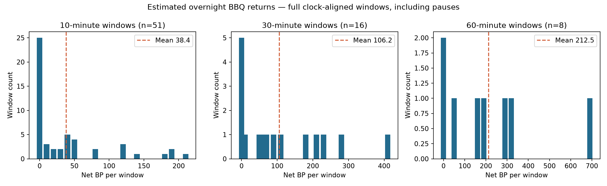
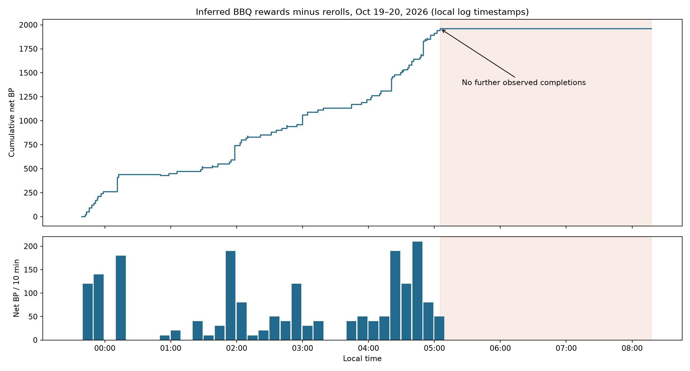

# Overnight BBQ BP reconstruction, October 19–20, 2026

The inferred ledger contains **2,050 BP earned, 90 BP rerolled, and 1,960 net BP**.
The largest loss was a roughly 3.2-hour stall after 05:05, not excessive reroll spending.

## Coverage and interpretation

Inputs are `SerialPrograms-20261020-032023983416.log` and `SerialPrograms.log`, in
that order. The October 17 archive has no BBQ runs. This analysis includes only
BBQ sessions from **Oct 19 23:39:08 through Oct 20 08:17:27**, including setup
failures and pauses. It excludes the later Flying Trial runs. Log timestamps
are used as local timestamps without timezone conversion.

This is a reconstruction of **automated quest earnings**, not an observed bank
balance. Rewards are assigned when a quest disappears between successive board
reads within the same run. Reroll replacements are excluded from rewards.
Incidental completions are included. Each event is dated at its first observed
disappearance; its true completion time is between two reads. There are no
BP balance snapshots to reconcile against, and manual actions between runs
cannot be reconstructed. OCR mistakes, same-type replacements and unobserved
completions can affect the estimate. The 61 inferred completions match the
sum of the recorded run completion counters (10 + 2 + 2 + 47), which is useful
consistency evidence, not independent proof of the game balance.

## Quest catalog and costs

[quest-catalog.csv](quest-catalog.csv) enumerates 85 variants, expanding all 18
types and the 3/4/5-block Ditto variants. Its 75 underlying slugs match the
repository's quest map. [quest-rewards.json](quest-rewards.json) is the join table.

| Family | Reward BP | Reroll BP |
| --- | ---: | ---: |
| Sneak-up, auto-10, travel, pickup-10, TM, catch-any | 20 | 10 |
| Flight/swimming/biome photos, Tera-self defeat | 30 | 10 |
| Catch a specified type | 40 | 10 |
| Wash, battle a wild Tera Pokémon | 100 | 50 |
| Auto-30, sandwich with three fillings | 130 | 50 |
| Tera Raid, flavored sandwich, specified-type photo | 150 | 50 |
| Hatch | 200 | 50 |
| Group photos | 400 | Not individually rerollable |
| Group four-star sandwich; full-hint catch | 500 | Not individually rerollable |
| Limited-hint catch | 600 | Not individually rerollable |
| Ditto blocks: 3 / 4 / 5 in any listed area | 500 / 550 / 600 | Not individually rerollable |

Values follow [Bulbapedia's quest table](https://bulbapedia.bulbagarden.net/wiki/Blueberry_Quest).
The 20-BP TM value is also supported by [Pro Game Guides](https://progameguides.com/pokemon-scarlet-and-violet/all-blueberry-quests-and-their-rewards-in-the-indigo-disk-pokemon-scarlet-violet/),
and the 100-BP wild-Tera/washing values by [Gamepur](https://www.gamepur.com/guides/how-to-get-blueberry-quests-in-pokemon-scarlet-violet-bbq-points-special-quests-explained).
The gold reroll limitation is described in [this GameFAQs Q&A](https://gamefaqs.gamespot.com/switch/359435-pokemon-scarlet/answers/637027-is-it-possible-to-turn-away-bb-point-tasks).
Gold quests do not occur in this solo run.

[Serebii](https://www.serebii.net/scarletviolet/blueberryquests.shtml) disagrees
on TM, wild-Tera, washing and biome group-photo values. Only TM (seven observed)
and wild-Tera (one observed) affect this ledger: using Serebii's alternatives
adds **190 BP**, giving **2,150 net BP**. This is a source-value sensitivity
calculation, not a statistical confidence interval.

## By run

| Start → stop | Inferred completions | Earned | Rerolled | Net BP |
| --- | ---: | ---: | ---: | ---: |
| 23:39:08 → 23:39:08, setup failure | 0 | 0 | 0 | 0 |
| 23:40:00 → 23:59:25 | 10 | 260 | 0 | 260 |
| 00:06:05 → 00:06:16, setup failure | 0 | 0 | 0 | 0 |
| 00:06:33 → 00:07:26, interrupted | 0 | 0 | 0 | 0 |
| 00:08:25 → 00:47:47 | 2 | 180 | 0 | 180 |
| 00:50:18 → 01:08:58 | 2 | 40 | 10 | 30 |
| 01:20:16 → 01:22:16, interrupted | 0 | 0 | 0 | 0 |
| 01:22:16 → 08:17:27 | 47 | 1,570 | 80 | 1,490 |
| Total | 61 | 2,050 | 90 | 1,960 |

All nine logged rerolls cost 10 BP and have a subsequent board change in the
target quest slug. Targets: Tera-self defeat five times; catch-poison, catch-bug,
catch-dark and catch-fairy once each. No 50-BP rerolls were observed.

## Return distributions

Returns below are **net BP per nonoverlapping clock-aligned interval**, including
program pauses. Only complete observed windows enter this table. Partial windows
are retained in [windows.csv](windows.csv), with observed and active minutes.
For 10 minutes, full windows cover 23:40–08:10; for 30/60 minutes, 00:00–08:00.
Thus sample means at different granularities cover slightly different periods.
P10/P90 use linear interpolation between ordered observations. These are empirical
distributions from one nonstationary night, not forecasts or confidence bounds.

| Window | N | Mean BP | Median BP | P10 | P90 | Min–max | Zero-return windows |
| --- | ---: | ---: | ---: | ---: | ---: | ---: | ---: |
| 10 min | 51 | 38.43 | 10 | 0 | 120 | 0–210 | 25 (49.0%) |
| 30 min | 16 | 106.25 | 65 | 0 | 255 | 0–410 | 5 (31.3%) |
| 60 min | 8 | 212.50 | 175 | 0 | 431 | 0–690 | 2 (25.0%) |





## What caused the low overnight return?

The longest run earned 1,490 net BP in 6.92 hours, about **215 BP/hour**.
Before the stall it earned those points in 3.72 hours, about **401 BP/hour**.
The whole overnight observation, including pauses, averaged about **227 BP/hour**.
The first 19-minute productive run was about **803 BP/hour**, a short sample that
should not be treated as sustainable throughput.

After the catch-any completion around **05:05:19**, the board remains
`photo-savanna`, `pickup-10`, `sneak-up`, fourth slot unreadable/absent. It is
unchanged over **203 board reads** through the last read at 08:16:39, before
stopping at 08:17:27. There are no further inferred rewards or rerolls.
During this period there are 29 photo batches and 29 Sneak-up batches (the final
Sneak-up batch is interrupted). Completed photo batches consume about **85.8
minutes**, and completed Sneak-up batches about **95.0 minutes**; none succeed.
The shared photo route logs `Photo: Normal/Fire` even though the requested board
quest is photo-savanna, so task-log route labels must not be mistaken for quest
identities. After the cutoff there are 59 `Taking photo.` messages and 59
`Photo not taken.` messages, plus 52 failed-battle-entry messages. The photo
routine uses absence of its expected photo prompt to emit `Photo not taken.`;
this does not by itself identify whether the target, camera state, or detector
was wrong.

The slot transitions explain the precise onset:

| Completion time | Quest removed | Board afterward |
| --- | --- | --- |
| 04:56:31 | catch-ground | photo-swim / pickup-10 / make-tm |
| 04:59:56 | make-tm | photo-swim / pickup-10 / catch-any |
| 05:02:21 | photo-swim | photo-savanna / pickup-10 / catch-any |
| 05:05:18 | catch-any | photo-savanna / pickup-10 / sneak-up |

Thus the last productive slot disappears at 05:05. This was not a simultaneous
failure of all quest types: travel, crafting, other photos and auto-battle had
continued producing new quests before the board became stuck.

Source inspection reveals a shared dependency: photo-savanna, catch-any and
sneak-up all use the timed **Savanna Plaza → Pride Rock** route. A common spawn
or positioning issue is a stronger lead than treating the two failing quests
as unrelated. Catch-any just succeeded there before the plateau; capturing a
shared target is a candidate explanation. However, both catching and Sneak-up
attempt a date skip to respawn fixed encounters. Depletion, a failed respawn,
loading delay and inaccurate positioning remain hypotheses requiring gameplay
screenshots. Photo-savanna also succeeded once earlier, at 23:51, and Sneak-up
last completed at 04:51.

Within the final continuous run, attempted-task mix changes as follows. Outcomes
are outer retry batches, not single button throws, and shared route labels are
kept grouped. Incidental completions may occur during other tasks.

| Task/route | 01:22–05:05 batches / successes | Minutes | 05:05–08:17 batches / successes | Minutes |
| --- | ---: | ---: | ---: | ---: |
| Sneak-up | 26 / 4 | 83.6 | 29 / 0 | 95.0 |
| Photo, Swimming/Water/Polar route | 8 / 7 | 16.1 | 0 | 0 |
| Auto-battle 10/30 | 10 / 10 | 58.0 | 0 | 0 |
| Travel | 8 / 8 | 11.1 | 0 | 0 |
| TM | 6 / 6 | 4.9 | 0 | 0 |
| In-flight/Psychic photo route | 4 / 4 | 4.6 | 0 | 0 |
| Any/Normal/Fire catch route | 4 / 2 | 17.4 | 0 | 0 |
| Other routes | 6 / 6 | 15.4 | 0 | 0 |
| Savanna/Normal/Fire photo route | 0 | 0 | 29 / 0 | 85.8 |

The final Sneak-up batch is censored; its partial time is not included in the
95.0 minutes. Even before the complete stall, Sneak-up consumes 83.6 minutes
while only four of its 26 batches succeed. Failure recovery therefore has
potential value beyond avoiding the final plateau.

Rerolling only pickup opens one slot but still leaves the same two failing
tasks consuming about six minutes per round. Rerolling only failed routes opens
two slots but leaves pickup unavailable. Doing both restores all three blue
slots for **30 BP at this particular board**, provided replacement quests are
productive; it does not require implementing pickup or free navigation.

At the pre-stall 401 BP/hour rate, three 10-BP rerolls cost only about **4.5
minutes** of productive opportunity, versus a 192-minute stall. Recovery that
restored that rate could recover around **1,250 net BP** after 30 BP of rerolls,
before menu time and replacement difficulty. This is a conditional estimate;
reroll chains and another bad route can reduce the gain.

For #263, prioritize persistent per-quest failure limits plus a board-level
no-progress policy. Fixing battle entry alone leaves the photo failure and
unsupported pickup slot. Keep the no-progress policy bounded: known bad quests
should be rerolled according to user policy, OCR should be retried, and uncertain
slots should not silently incur repeated charges. Then investigate landing,
spawn waits and target search using screenshots and timestamped attempt IDs.

## Reproduce

Run from the repository root (the raw logs remain local, outside Git):

```sh
python3 skills/serialprograms-logs/scripts/bbq_ledger.py \
  '/Users/difan/Library/Application Support/SerialPrograms/SerialPrograms-20261020-032023983416.log' \
  '/Users/difan/Library/Application Support/SerialPrograms/SerialPrograms.log' \
  --rewards analysis/bbq-2026-10-20/quest-rewards.json \
  --output analysis/bbq-2026-10-20
env MPLCONFIGDIR=/private/tmp/bbq-matplotlib \
  .cache/build-tools/bin/python analysis/bbq-2026-10-20/render_report.py
```

[events.csv](events.csv) contains 70 ledger entries with original filename/line
references; [boards.csv](boards.csv) contains 486 board reads;
[tasks.csv](tasks.csv) records task durations and censored tasks;
[runs.csv](runs.csv) preserves session boundaries. These derived files contain
timestamps and game quest identifiers, not private settings or raw logs.

For the requested quest-type velocity comparison, run
`python3 analysis/bbq-2026-10-20/quest_velocity.py` after rebuilding the ledger.
[quest-velocity.csv](quest-velocity.csv) separates the continuous pre-stall run
from all earlier sessions, including failed and censored batches. Requested
quest identity is reconstructed from the processing queue, rather than inferred
from shared route labels. Direct reward totals are checked against successful
batch counts. The optional bonus-progress credit column is a decision-model
illustration and is not part of earned BP.

The staged implementation proposal is in
[BBQImprovementPlan.md](../../CodingAgentContext/BBQImprovementPlan.md).
