# BDSP Static Legendary RNG Manipulation — Engineering Design

## Executive Summary

This repository (`bdsp/core-adopt` / `#772`) already contains a clean, modular, Qt-free BDSP RNG foundation built for `StarterRng` (`Xorshift128`, GF(2) solver, periodic player/NPC blink extraction, Munchlax float-interval `IntroSeedFinder`, `BdspStaticSearcher`, `AdvanceClock`, `RngTimeline`, `RngAim`, `SummaryReader`, and `BdspRngFilterTable`). Better yet, [Pokemon_BdspRng.cpp](SerialPrograms/Source/Pokemon/Pokemon_BdspRng.cpp) **already implements** 3-flawless-IV generation, Hidden Abilities (`ability_kind = 2`), arbitrary gender ratios, Synchronize nature forcing, shiny-lock handling, and `XoroshiroBDSP` roamer generation.

However, extending from Lake Verity Starters to all **26+ BDSP Static Legendaries, Mythicals, and Bonus Encounters** exposes **five critical architectural differences** that must be solved cleanly without regressing `StarterRng`:

1. **The 3D Pokémon Model Blink Problem (Fundamental Engine Constraint)**:
   In BDSP, human characters (including the Player) roll blinks on a strict **periodic `~1.017s` timer** (`bits 1..3 == 0`), which [PokemonBDSP_StateSolver.cpp](SerialPrograms/Source/PokemonBDSP/Programs/RngManipulation/PokemonBDSP_StateSolver.cpp) (`solve_state_from_samples`) requires. By contrast, **loaded 3D Pokémon overworld models** (spawned Ramanas Park legendaries, Dialga/Palkia, Uxie/Azelf, Giratina, Heatran, Regigigas, Darkrai, Arceus) roll blinks on an **aperiodic state-dependent float timer (`[3.285s, 12.285s]`)**. Running periodic player-blink state recovery while a 3D legendary model is simultaneously consuming `rng.next()` misaligns the GF(2) matrix equations and fails to solve.
2. **Two Complementary Seed + Anchor Workflows Solve Every Chamber**:
   - **Workflow A — Quiet-Room Player Blink (`npcs = 1, pokemon_models = 0`) + Room-Entry / Pedestal Timeline**: Save 1 step outside the chamber (Dialga/Palkia, Uxie/Azelf, Giratina) or before triggering a non-model encounter (Rotom TV, Ramanas empty pedestal), recover the 128-bit state from player blinks, then enter the chamber and use `simulate_timeline({npcs = 1, pokemon_models = 1})` to place the final `A` press inside a blink-free gap (`delay ≈ 84`).
   - **Workflow B — Boot-Time Munchlax `IntroSeedFinder` + In-Chamber `1PK` Re-Identification (`reidentify_with_pokemon_models`)**: Recover the 128-bit `Xorshift128` seed on the **Munchlax intro screen** (which persists across loading the save file and is **100% invariant to player model, Veilstone outfits, room lighting, and camera zoom**), load directly in front of the saved Legendary (Ramanas Park *after* inserting a slate—critical for random-pool Discovery/Kanto/Johto/Soul slates!—plus Heatran, Regigigas, Darkrai, Hall of Origin Arceus, and Roamers), re-identify the exact advance in ~60s accounting for `1 Player + 1 Pokémon Model` (`1PK`), and fire on the target advance.
3. **Existing Scaffold Bugs & Hardcoded Starter Assumptions Caught During Audit**:
   - [PokemonBDSP_RngTargets.cpp](SerialPrograms/Source/PokemonBDSP/Programs/RngManipulation/PokemonBDSP_RngTargets.cpp) currently scaffolds `Giratina` at Lv. 47 (actual: **Lv. 70**), `Regirock/Regice/Registeel` at Lv. 30 with `ability_kind = 3` (actual in Ramanas Park: **Lv. 70** with forced Hidden Ability `ability_kind = 2`), and omits the 8th `BdspTimelineContext` field (`advances_after_accept = 0` instead of `~84`).
   - [PokemonBDSP_SummaryReader.cpp](SerialPrograms/Source/PokemonBDSP/Inference/Rng/PokemonBDSP_SummaryReader.cpp#L115-L146) hardcodes Level-5 starter stat bounds (`5..40` non-HP, 2-digit `15..30` HP), which rejects every Level 30–80 Legendary stat (`60..350+`).
   - [PokemonBDSP_SummaryNavigation.cpp](SerialPrograms/Source/PokemonBDSP/Programs/RngManipulation/PokemonBDSP_SummaryNavigation.cpp#L50-L92) assumes the pre-Pokédex 2-icon X menu and Party Slot 1, whereas Legendary hunters have the 7-icon X menu and up to 6 party members (e.g., Regigigas requires all 3 Regis in party).
   - [PokemonBDSP_TargetSelection.cpp](SerialPrograms/Source/PokemonBDSP/Programs/RngManipulation/PokemonBDSP_TargetSelection.cpp#L95) and [PokemonBDSP_RngCalibration.cpp](SerialPrograms/Source/PokemonBDSP/Programs/RngManipulation/PokemonBDSP_RngCalibration.cpp#L152) do not pass `synchronize_nature` to `BdspStaticSearcher`. Adding Synchronize boosts Shiny + Desired Nature target density by **25×** (`1/4096` instead of `1/102,400`) and accounts for the skipped nature roll (`-1` shift on height/weight).
4. **Shaymin Anomaly (`~279 advances/sec`)**:
   Flower Paradise's blowing flower petals consume ~279 RNG advances/sec continuously, making standard blink-timed static RNG unviable on overworld Flower Paradise; `ShinyHunt-Shaymin` runaway remains the right shiny tool unless using an advanced Underground/menu-buffer flow.
5. **Stream History (`STREAM_HISTORY`) Silent Failure Mode**:
   `StreamHistoryOption` defaults to **`DEFAULT_ENABLED` on beta builds** (`10 FPS`, `720p` smooth CPU scale + JPEG `imencode`). A single 80–120 ms frame stall during the second dip of a Double blink (`bit 0 = 1`) causes `group_blinks()` to misclassify it as `BlinkType::Single` (`bit 0 = 0`), injecting a hard GF(2) contradiction into `solve_state_from_samples()` that ruins an entire 52-blink (~7 min) window.

---

## 1. Reusable Core vs. Per-Encounter Delta

### 1.1 Module-by-Module Reuse Audit

| Existing Module | File(s) | Status | What Works As-Is vs. Exact Generalization Needed |
| :--- | :--- | :--- | :--- |
| **PRNG & GF(2) Math** | [Pokemon_Xorshift128.h](SerialPrograms/Source/Pokemon/Pokemon_Xorshift128.h), [Pokemon_Gf2Matrix.h](SerialPrograms/Source/Pokemon/Pokemon_Gf2Matrix.h), [Pokemon_Xoroshiro128Plus.h](SerialPrograms/Source/Pokemon/Pokemon_Xoroshiro128Plus.h) | **Reuse 100% As-Is** | 128-bit `Xorshift128`, $O(\log N)$ jump matrices, `Xorshift128List<64>` window, and `gf2_solve_128` null-space solver need zero changes. |
| **BDSP Static & Roamer Generator** | [Pokemon_BdspRng.h](SerialPrograms/Source/Pokemon/Pokemon_BdspRng.h), [Pokemon_BdspRng.cpp](SerialPrograms/Source/Pokemon/Pokemon_BdspRng.cpp) | **Reuse ~98% As-Is** | Already supports `guaranteed_ivs = 3`, `ability_kind` (`0/1` fixed, `2` HA with dummy `source.next()`, `3` `source.next(2)`), `gender_ratio` (`0`, `127`, `254`, `255`), `shiny_locked`, `roamer` (`XoroshiroBDSP`), and `synchronize_nature`. **Delta**: Verify `ability_kind` (`0` vs `3`) on single-ability Sinnoh statics and Synchronize behavior on `bdsp_generate_roamer` against PokeFinder `StaticGenerator8b` / `RoamerGenerator8b` (see §1.2). |
| **Blink Physics & Solver** | [PokemonBDSP_BlinkModel.h](SerialPrograms/Source/PokemonBDSP/Programs/RngManipulation/PokemonBDSP_BlinkModel.h), [PokemonBDSP_StateSolver.h](SerialPrograms/Source/PokemonBDSP/Programs/RngManipulation/PokemonBDSP_StateSolver.h) | **Reuse 100% As-Is** | Both solvers—`solve_state_from_samples` (periodic human blinks, already supporting `std::optional<BlinkType>`) and `solve_state_from_pokemon_blinks` (aperiodic Munchlax float intervals)—work out of the box. |
| **Eye Template Matcher & Extraction** | [PokemonBDSP_EyeBlinkDetector.h](SerialPrograms/Source/PokemonBDSP/Inference/Rng/PokemonBDSP_EyeBlinkDetector.h), [PokemonBDSP_BlinkExtraction.h](SerialPrograms/Source/PokemonBDSP/Inference/Rng/PokemonBDSP_BlinkExtraction.h) | **Minor Enhancement** | `EyeBlinkWatcher` and `extract_blinks` work as-is. **Delta**: Add sample-timestamp gap tracking (`max_gap_ms`) and return `std::optional<BlinkType>` (`std::nullopt` when a frame drop `> 65ms` occurs inside `[t + 0.15s, t + 0.55s]`) so dropped frames never poison `bit 0` (see §5). |
| **Intro Seed Finder (Munchlax)** | [PokemonBDSP_IntroSeedFinder.cpp](SerialPrograms/Source/PokemonBDSP/Programs/RngManipulation/PokemonBDSP_IntroSeedFinder.cpp) | **Extract Reusable Function** | Currently embedded inside `IntroSeedFinder::program()`. **Delta**: Extract `recover_intro_munchlax_state(env, context, collection_display, state_display)` into a shared helper so both `IntroSeedFinder` and `StaticLegendaryRng` (Workflow B) call the exact same routine on boot before mashing `ZL` through the title screen. |
| **Overworld Blink Recovery** | [PokemonBDSP_BlinkRecovery.h](SerialPrograms/Source/PokemonBDSP/Programs/RngManipulation/PokemonBDSP_BlinkRecovery.h), [PokemonBDSP_AdvanceClock.h](SerialPrograms/Source/PokemonBDSP/Programs/RngManipulation/PokemonBDSP_AdvanceClock.h) | **Minor Generalization** | Works as-is for `npcs = 1` quiet rooms (`BedroomSeedFinder` already uses `config.npcs = 1`). **Delta**: Allow `min_rolls_to_try = 38` for `npcs = 1` (~152 equations, saving ~50s vs 44 blinks), add overworld cave/pedestal player eye scene configs in `PokemonBDSP_BlinkScenes.{h,cpp}`, and add an overload of `hold_and_reanchor` supporting `1PK` re-identification when holding in front of a spawned Legendary. |
| **State Re-Identifier** | [PokemonBDSP_StateReidentifier.h](SerialPrograms/Source/PokemonBDSP/Programs/RngManipulation/PokemonBDSP_StateReidentifier.h) | **Extend (`1PK` Mode)** | Currently supports `Intervals` and `Types` for pure periodic `npcs >= 1` (`pokemon_models = 0`). **Delta**: Add `reidentify_with_pokemon_models()` (`1 Player + 1 Pokémon Model`) for in-chamber saves after Munchlax boot seed or room walk-in (see §1.3). |
| **RNG Targets Table** | [PokemonBDSP_RngTargets.h](SerialPrograms/Source/PokemonBDSP/Programs/RngManipulation/PokemonBDSP_RngTargets.h), [PokemonBDSP_RngTargets.cpp](SerialPrograms/Source/PokemonBDSP/Programs/RngManipulation/PokemonBDSP_RngTargets.cpp) | **Fix Bugs & Expand** | Fix `Giratina` level (`47 → 70`), `Regirock/Regice/Registeel` level & ability (`30 → 70`, `ability_kind = 3 → 2`), and missing `advances_after_accept` (`0 → 84`). Expand to all 26 targets with `BaseStats`, gender ratios, ability kinds, and encounter execution descriptors. |
| **Timeline Simulator & Execution** | [PokemonBDSP_RngTimeline.h](SerialPrograms/Source/PokemonBDSP/Programs/RngManipulation/PokemonBDSP_RngTimeline.h), [PokemonBDSP_RngExecution.h](SerialPrograms/Source/PokemonBDSP/Programs/RngManipulation/PokemonBDSP_RngExecution.h) | **Keep Starter + Add Static** | `simulate_timeline()` already simulates `npcs` periodic ticks + `pokemon_models` float blinks after `white_delay_seconds` and `advance_delay`! However, `schedule_presses()` in `RngExecution.cpp` hardcodes Lake Verity's 3-press Starly/briefcase sequence. **Delta**: Leave `schedule_presses()` untouched for `StarterRng`; add `StaticPressSchedule` + `schedule_static_presses()` for single-confirm static timelines and `pokemon_models == 0` direct triggers (see §1.4). |
| **Target Selection & Calibration** | [PokemonBDSP_TargetSelection.h](SerialPrograms/Source/PokemonBDSP/Programs/RngManipulation/PokemonBDSP_TargetSelection.h), [PokemonBDSP_RngCalibration.h](SerialPrograms/Source/PokemonBDSP/Programs/RngManipulation/PokemonBDSP_RngCalibration.h), [PokemonBDSP_RngAim.h](SerialPrograms/Source/PokemonBDSP/Programs/RngManipulation/PokemonBDSP_RngAim.h) | **Generalize** | Pass `uint8_t synchronize_nature = BDSP_NO_SYNCHRONIZE` into `TargetSearchRequest`, `select_target()`, and `identify_hit_advance()`. Support `StaticPressSchedule` in target selection. Alias `using BdspObservedPokemon = BdspObservedStarter;` and add optional `IvJudgeReader::Results` matching alongside `StatReads`. Add `initial_bias` support to `RngAim`. |
| **Summary & Box Verification** | [PokemonBDSP_SummaryReader.cpp](SerialPrograms/Source/PokemonBDSP/Inference/Rng/PokemonBDSP_SummaryReader.cpp), [PokemonBDSP_SummaryNavigation.cpp](SerialPrograms/Source/PokemonBDSP/Programs/RngManipulation/PokemonBDSP_SummaryNavigation.cpp) | **Fix Bounds & Add Box Path** | Parameterize `SummaryReader::read_stats()` with legal `[min_stat, max_stat]` bounds computed from `BaseStats` + `level` (supporting 3-digit stats up to 500 and `HP/HP` 6-digit strings). Add post-Pokédex PC Box inspection (`overworld_to_box` + `BoxNatureDetector` + `IvJudgeReaderScope` + Summary from Box) so any party size `1..6` works. |
| **Filter, Displays, Battle & Catch** | [PokemonBDSP_RngFilter.h](SerialPrograms/Source/PokemonBDSP/Options/PokemonBDSP_RngFilter.h), [PokemonBDSP_RngDisplays.h](SerialPrograms/Source/PokemonBDSP/Programs/RngManipulation/PokemonBDSP_RngDisplays.h), [PokemonBDSP_ShinyEncounterDetector.h](SerialPrograms/Source/PokemonBDSP/Inference/ShinyDetection/PokemonBDSP_ShinyEncounterDetector.h), [PokemonBDSP_BasicCatcher.h](SerialPrograms/Source/PokemonBDSP/Programs/PokemonBDSP_BasicCatcher.h) | **Reuse 100% As-Is** | `detect_shiny_battle(..., WILD_POKEMON, ...)` (used in `LegendaryReset`), `basic_catcher()`, `overworld_to_box()`, `BdspRngFilterTable`, and `RngDisplays` work directly. |

---

### 1.2 Generator Details: TSV Independence, Synchronize, & Ability Rolls

1. **Why User SID / TSV Is NOT Required for Shiny Static Legendaries**:
   In [Pokemon_BdspRng.cpp](SerialPrograms/Source/Pokemon/Pokemon_BdspRng.cpp#L169-L182), `resolve_shiny()` computes shininess from the generated fake trainer ID `sidtid = source.next()` and `raw_pid = source.next()`:
   ```cpp
   BdspShiny shiny = bdsp_get_shiny(pid, (uint16_t)((sidtid >> 16) ^ (sidtid & 0xffff)));
   ```
   The player's actual `tsv` is **only** used afterward by `force_shiny()` / `force_not_shiny()` to rewrite the high 16 bits of `result.pid` so the Pokémon renders shiny (or non-shiny) for the player's Trainer ID. Thus `tsv = 0` predicts **exact Star/Square/None shininess, EC, IVs, Ability, Gender, Nature, Height, and Weight** with zero user SID setup.

2. **Synchronize Lead Support**:
   In BDSP static encounters, an active or fainted **Slot 1 Pokémon with `Synchronize`** forces `result.nature = lead_nature` with **100% probability** and **skips the `source.next(25)` nature RNG call** (already modeled in [Pokemon_BdspRng.cpp](SerialPrograms/Source/Pokemon/Pokemon_BdspRng.cpp#L250-L253)).
   - **Impact on wait time**: Without Synchronize, a Shiny + Specific Nature spread occurs once every `4096 × 25 = 102,400` advances (~29 hours at 1 NPC tick/sec without Pokédex skipping, or ~5.2 minutes of Pokédex scrolling). With Synchronize, **every shiny advance (`1/4096`) has the target nature** (~69 minutes worst-case idle wait, or ~12 seconds of Pokédex scrolling!).
   - **Roamer Synchronize Caveat**: For Mesprit and Cresselia, IVs, EC, and Shininess are locked when released via `XoroshiroBDSP(ec)` (`bdsp_generate_roamer`), whereas BDSP applies Synchronize to override the roamer's nature **when entering the wild grass battle**, not at release. In PR Slice 1, we must verify against PokeFinder's `RoamerGenerator8b.cpp` whether `roamer.next_uint(25)` is always consumed inside `XoroshiroBDSP(ec)` even when a Synchronize lead is present at release (affects only `height`/`weight` of the roamer).

3. **`ability_kind` Verification**:
   - **Ramanas Park catchable legendaries**: All have forced Hidden Ability (`ability_kind = 2`), except species with no Hidden Ability (`Latios`, `Latias`, `Kyogre`, `Groudon`, `Rayquaza` — all single-ability species). Note that in `generate_static_impl`, both `ability_kind = 2` and `ability_kind = 3` consume **1** `source.next()` call, whereas `ability_kind = 0` consumes **0** calls. Slice 1 unit tests will lock down `ability_kind` for single-ability species (`Levitate` / `Drizzle` / `Drought` / `Air Lock` / `Pressure` / `Multitype` / `Bad Dreams` / `Natural Cure`) directly against PokeFinder 4.x reference outputs.

---

### 1.3 Solving the `1PK` In-Chamber Re-Identification Problem

Saving **inside** the encounter chamber directly facing the Legendary (after inserting the Ramanas Park slate, or on the Hall of Origin stairs before Arceus, or in front of Heatran/Regigigas/Darkrai/Cresselia/Mesprit) is vastly cleaner for users than multi-room blind walks:
- In Ramanas Park, **Discovery, Kanto, Johto, and Soul Slates** pick randomly among remaining uncaught trio/duo members upon slate insertion; saving *after* inserting the slate locks the exact species and skips the slate cutscene on every reset.
- For Heatran (Stark Mountain) and Regigigas (Snowpoint Temple), walking from an outer room crosses ice puzzles or 16-NPC rooms (`~1,300+` noisy advances).

**How Workflow B (`Munchlax Boot Seed` + `1PK Re-Identification`) Works Automagically**:
1. On game launch (`from_home_close_and_reopen_game` → Munchlax intro cutscene), `recover_intro_munchlax_state()` watches `Munchlax.png` for ~45–55 blinks (~6.5 min) and recovers the exact boot `Xorshift128State` (`seed_boot`).
2. Program mashes `ZL` through the title screen into the overworld save (`gamemenu_to_ingame`), spending ~2,000–15,000 advances during save load.
3. Upon entering the overworld (at `t = t_load`), the player character (`npcs = 1`) and the single spawned Legendary (`pokemon_models = 1`) initialize their blink timers (`seed_timeline_queue`), or—if we open & close the Pokémon/Bag full-screen menu once—re-initialize cleanly at `t = t_close`!
4. Player faces the camera (or opens Rowan's key-item prompt via `BUTTON_Y` / registered key item if needed to freeze idle fidgets) and watches **only the player's eye** for `8–12` player blinks (~65–95s).
5. `reidentify_with_pokemon_models()` searches `start_advance ∈ [search_min, search_max]` (e.g., `[500, 40000]`):
   - **Fresh-scene mode** (post-load or post-menu-close): Runs `simulate_timeline(rng_at(s), {npcs = 1, pokemon_models = 1})` and matches predicted player blink tick indices and `BlinkType`s against observed player blinks. Not only does this pin down `s` uniquely in `< 5 ms`, it also **locks the exact phase of the Legendary's next float blink**!
   - **General unseeded `1PK` mode** (periodic re-anchor): Between consecutive player blinks separated by $\Delta k$ player ticks ($\Delta t = \Delta k \cdot T_{\text{tick}}$), 1 Pokémon model can consume only $p \in [\lfloor \Delta t / 12.285 \rfloor, \lceil \Delta t / 3.285 \rceil]$ advances, and once its first blink time $u_1 \in (t_0, t_0 + 12.285\text{s}]$ (discretized on a `0.1s` grid) is chosen, all subsequent Pokémon blink times $u_2, u_3, \dots$ are deterministic functions of `rng.next()`. Filtering candidate `s` by `nibble_blinked(nibbles[s])` + 8–10 player blinks yields a unique `(current_advance, next_pokemon_blink_window)` in `< 10 ms`.

---

### 1.4 Static Timeline vs. Starter Timeline (`RngExecution`)

`StarterRng` needs 3 timed inputs (`briefcase` → `starly` after 10 events → `select` + `confirm` inside one free 2-Starly gap, total span `~171` advances).
Static Legendaries need a much simpler `StaticPressSchedule`:

```cpp
enum class StaticTriggerKind : uint8_t{
    DirectNoPokemonModel,   // pokemon_models == 0 (e.g., Rotom TV, empty pedestal)
    TimelineSingleConfirm,  // Enter room / close menu -> open cry dialog -> press A in safe gap
};

struct StaticPressSchedule{
    uint64_t span = 0;               // Total advances from press_advance to generation
    double confirm_seconds = 0.0;    // Seconds from timeline start (press_advance) to final A / step
    uint64_t events_before_confirm = 0;
    double gap_margin_seconds = 0.0; // Distance to nearest player/Pokemon blink edge
};
```

- For **`DirectNoPokemonModel`** (`pokemon_models == 0`): No stochastic Pokémon blinks occur during approach; `span = timeline.advance_delay + timeline.advances_after_accept` is constant (`~84`), so **100% of target advances are reachable** and the final `A` press is timed directly off `recovery.clock.middle_of_advance(press_advance)`.
- For **`TimelineSingleConfirm`** (`npcs = 1, pokemon_models = 1`): At `press_advance`, the program triggers room entry / menu close (`t = 0`), walks/interacts to rest on the Legendary's cry text box by `t = timings.ready_seconds` (e.g., `4.5s`–`8.0s`), and scans `simulate_timeline()` gaps `[at[k], at[k + 1]]` for `confirm_seconds = std::max((at[k] + at[k + 1]) / 2.0, timings.ready_seconds + timings.guard_seconds)` with `>= guard_seconds` (`0.30s`) clearance on both sides, yielding `span = (k + 1) + timeline.advances_after_accept`.

---

## 2. Encounter Matrix

### 2.1 Caveats & Pre-Flight Rules Across All Encounters
- **Shiny-Locked Gifts (Excluded from Shiny RNG)**: **Mew** (Lv. 1, Floaroma Town elderly woman, LGPE save bonus) and **Jirachi** (Lv. 5, Floaroma Town elderly man, SwSh save bonus) have `shiny_locked = true` (`PID ^= 0x10000000` if shiny) and stand outdoors in flower-petal/NPC-heavy Floaroma Town. They **cannot** be shiny in BDSP and must not appear as shiny-huntable targets.
- **Uncatchable Ramanas Boss**: **Origin Giratina (Lv. 100, Distortion Room)** in Ramanas Park cannot be caught (defeating it awards the Griseous Orb). Catchable Giratina is **Turnback Cave (Lv. 70)**.
- **Autosave**: Must be **OFF** in BDSP Settings before starting any RNG program.
- **Lead Pokémon**: Non-shiny lead (so `LeadingShinyTracker` never false-positives); optional **Synchronize** lead (active or fainted in Slot 1) matching the user's `SYNCHRONIZE_NATURE` option.

### 2.2 Master Encounter Matrix

| Encounter Group & Species | Lv / Guaranteed IVs / Gender / Ability | Recommended Save Spot | Human NPCs / PKMN Models | Seed & Re-Anchor Strategy | Advance-Skipping Options | Trigger Input | Approx. Blind Delay (`advances_after_accept`) & Calibration | Shiny & Hit Verification |
| :--- | :--- | :--- | :--- | :--- | :--- | :--- | :--- | :--- |
| **Ramanas Park — Fixed Slates**<br>• **Ho-Oh** (BD Rainbow)<br>• **Lugia** (SP Squall)<br>• **Kyogre** (Oceanic)<br>• **Groudon** (Tectonic)<br>• **Rayquaza** (Stratospheric)<br>• **Mewtwo** (Genome) | Lv 70, `3` IVs, Genderless (`255`)<br>• Ho-Oh/Lugia/Mewtwo: HA (`ability_kind=2`)<br>• Kyogre/Groudon/Rayquaza: Single ability | **Option A (Post-Slate, Recommended)**: Inside mysterious room 1 tile south of Legendary, facing camera.<br>**Option B (Pre-Slate)**: Facing empty pedestal before inserting slate. | • Post-Slate: `1` human (player) + `1` PKMN<br>• Pre-Slate: `1` human + `0` PKMN | • Post-Slate: **Munchlax Intro + `1PK` Re-ID** (or Bag/Pokémon menu-close timeline)<br>• Pre-Slate: **Overworld Player Blink** (`npcs=1`) + Slate Timeline (`white=3.0s, delay=3`) | **Pokédex scroll** (`~150–300` adv/scroll) up to `-300` buffer, then idle wait | Press `A` to open cry box (`"Gyaoo!"` etc.), then timed final `A` on cry box | **`~84`** advances after final `A` (`RngAim` auto-calibrates after 1st test catch or 3 misses) | `detect_shiny_battle(WILD_POKEMON)` → Stop / Master Ball / `basic_catcher` → Box/Summary OCR |
| **Ramanas Park — Pool Slates**<br>• **Regirock / Regice / Registeel** (Discovery)<br>• **Articuno / Zapdos / Moltres** (SP Kanto)<br>• **Raikou / Entei / Suicune** (BD Johto)<br>• **Latios** (`M`, `0`) / **Latias** (`F`, `254`) (Soul) | Lv 70, `3` IVs<br>• Regis/Birds/Beasts/Mewtwo: Genderless (`255`), HA (`ability_kind=2`)<br>• Latios (`0` M) / Latias (`254` F): Levitate | **Save AFTER inserting slate** directly in front of the spawned Legendary! *(Locks which trio/duo species spawned & avoids extra pool-selection RNG roll on slate insert.)* | `1` human (player) + `1` PKMN | **Munchlax Intro + `1PK` Re-ID** + Menu-Close `TimelineSingleConfirm` | **Pokédex scroll** to `-300` buffer, then menu-close timeline | Press `A` for cry dialog, then timed final `A` on cry dialog | **`~84`** advances after final `A` | Same as above *(Latios/Latias gender is fixed `0`/`254`; IVs/Nature/Stats verify hit)* |
| **Dialga** (BD) / **Palkia** (SP)<br>*(Spear Pillar — Post-E4 Respawn or Story)* | Lv 47, `3` IVs, Genderless (`255`), Pressure | **Post-E4 (Cleanest)**: Inside Mt. Coronet top cave mouth 1 step before Spear Pillar exit, facing camera *(0 NPCs, 0 PKMN, dark indoor background)*. *(Story encounter has Mars/Jupiter/Cyrus before post-Galactic step; save only after Commanders leave or post-E4.)* | Outside cave: `1` human + `0` PKMN<br>On Spear Pillar: `1` human + `1` PKMN | **Overworld Player Blink** inside cave mouth (`npcs=1`) + `hold_and_reanchor` → Walk out onto Spear Pillar (`white=2.0s, delay=0`) + `TimelineSingleConfirm` | **Pokédex scroll** inside cave mouth + `reanchor_absolute` (`npcs=1`) | Walk north to Dialga/Palkia, `A` for roar box, timed **2nd `A`** to start battle | **`~84`** advances after 2nd `A` | `detect_shiny_battle(WILD_POKEMON)` → Catch + Box/Summary OCR (Lv 47 stats) |
| **Uxie** (Acuity Cavern)<br>**Azelf** (Valor Cavern) | Lv 50, `3` IVs, Genderless (`255`), Levitate | **Option A**: 1 step outside cavern entrance (after Galactic leaves; 0 NPCs) or<br>**Option B**: Directly in front of Uxie/Azelf (facing squarely so its head does not turn on `A`!) | Outside: `1` human + `0` PKMN<br>Inside: `1` human + `1` PKMN | **Munchlax Intro + `1PK` Re-ID** inside cavern (weather-proof vs Acuity snow!) OR Overworld Player Blink + Cavern-Entry Timeline | **Pokédex scroll** + `1PK` re-ID / menu-close timeline | `A` to open `"Kloosh!"` / cry box, timed **2nd `A`** to start battle | **`~84`** advances after 2nd `A` | `detect_shiny_battle(WILD_POKEMON)` → Catch + Box/Summary OCR (Lv 50 stats) |
| **Giratina**<br>*(Turnback Cave)* | Lv 70, `3` IVs, Genderless (`255`), Pressure | **Pillar Room #3** (1 room before Giratina's chamber, 0 NPCs, 0 PKMN) OR directly in front of Giratina | Pillar Room: `1` human + `0` PKMN<br>Chamber: `1` human + `1` PKMN | **Overworld Player Blink** in 3rd Pillar Room (`npcs=1`) + Room-Entry Timeline (`white=2.0s, delay=2`) OR **Munchlax Intro + `1PK` Re-ID** in front of Giratina | **Pokédex scroll** in Pillar Room + `reanchor_absolute` | `A` to open `"Bishaaan!"` box, timed **2nd `A`** to start battle | **`~84`** advances after 2nd `A` | `detect_shiny_battle(WILD_POKEMON)` → Catch + Box/Summary OCR (Lv 70 stats; bring Scrappy/Foresight or Master Ball for Ghost!) |
| **Heatran**<br>*(Stark Mountain Inner Chamber)* | Lv 70, `3` IVs, **50% M / 50% F (`127`)**, Flash Fire | **Inside Heatran's inner chamber**, 1 tile south of Heatran *(outer Stark Mountain cavern has 16 NPCs → ~1,300 noisy advances if walking in!)* | `1` human + `1` PKMN | **Munchlax Intro + `1PK` Re-ID** (with Rowan key-item dialog or facing camera) + Menu-Close `TimelineSingleConfirm` | **Pokédex scroll** down to `-250` buffer, then `1PK` re-ID + menu-close timeline | `A` to open `"Gwogbogogo..."` box, timed **2nd `A`** to start battle | **`~84`** advances after 2nd `A` | `detect_shiny_battle(WILD_POKEMON)` → Catch + Box/Summary OCR (Gender + Lv 70 stats give instant unique ID!) |
| **Regigigas**<br>*(Snowpoint Temple B6F)* | Lv 70, `3` IVs, Genderless (`255`), Slow Start<br>*(Requires Regirock, Regice, Registeel in party!)* | **Inside B6F directly in front of Regigigas statue** *(B5F requires sliding across ice puzzle!)* | `1` human + `1` PKMN *(verify whether dormant statue blinks before awakening; support both `0PK` and `1PK`!)* | **Munchlax Intro + `1PK` (or `0PK`) Re-ID** directly in front of Regigigas | **Pokédex scroll** down to `-250` buffer + re-ID | `A` through awakening text to `"Zut Zutt!"` box, timed **final `A`** | **`~84`** advances after `"Zut Zutt!"` `A` | `detect_shiny_battle(WILD_POKEMON)` → Catch + **PC Box OCR** *(party may have 4–6 Pokémon due to 3 Regis!)* |
| **Darkrai**<br>*(Newmoon Island — Member Card)* | Lv 50, `3` IVs, Genderless (`255`), Bad Dreams | **Inside Newmoon Island clearing**, 1 tile south of Darkrai | `1` human + `1` PKMN | **Munchlax Intro + `1PK` Re-ID** + Menu-Close `TimelineSingleConfirm` | **Pokédex scroll** down to `-250` buffer + `1PK` re-ID | `A` to open `"..."` / awakening text box, timed **final `A`** | **`~84`** advances after final `A` | `detect_shiny_battle(WILD_POKEMON)` → Catch + Box/Summary OCR (Lv 50 stats) |
| **Arceus**<br>*(Hall of Origin — Azure Flute)* | Lv 80, `3` IVs, Genderless (`255`), Multitype | **Mode A (Recommended)**: Saved near top of **Hall of Origin glass stairs** (1 step below trigger tile).<br>**Mode B**: Inside Mt. Coronet cave mouth before Spear Pillar (pre-Azure Flute). | • Mode A (Stairs): `1` human + `1` PKMN<br>• Mode B (Cave): `1` human + `0` PKMN | • Mode A: **Munchlax Intro + `1PK` Re-ID** on stairs + Menu-Close Timeline<br>• Mode B: **Overworld Player Blink** in cave + Flute Timeline | **Pokédex scroll** + re-ID | • Mode A: **`DPAD_UP` step-forward** onto trigger tile (`Dodogyuuun!` auto-plays into battle!)<br>• Mode B: `A` on *"Play the Azure Flute?"* `Yes` + walk up stairs | • Mode A (Stairs step): **`~84–90`** (auto-calibrated)<br>• Mode B (Flute `Yes`): **`~133`** | `detect_shiny_battle(WILD_POKEMON)` → Master Ball / Catch + Box/Summary OCR (Lv 80 stats) |
| **Shaymin**<br>*(Flower Paradise — Oak's Letter)* | Lv 30, `3` IVs, Genderless (`255`), Natural Cure | **Special Case — Out of Scope for v1 Blink RNG** *(see §2.3)* | `1` human + `1` PKMN + **~279 adv/sec flower petals!** | Overworld blink RNG is overwhelmed by ~279 adv/sec petal RNG noise (`±3.6 ms` per advance!) | N/A (petals advance ~16,700/min on their own) | `A` on Shaymin | Unstable (`±5–15` advance scatter per frame of latency) | **Use existing [ShinyHunt-Shaymin](SerialPrograms/Source/PokemonBDSP/Programs/ShinyHunting/PokemonBDSP_ShinyHunt-Shaymin.cpp) runaway** (~35s/encounter, no resets!) |

### 2.3 Bonus Analysis: Roamers, Non-Legendary Statics, & Shaymin

1. **Roamers — Mesprit (Verity Cavern, Lv. 50, Genderless) & Cresselia (Fullmoon Island, Lv. 50, Female `254`)**:
   - **What Fits**: `bdsp_generate_roamer()` in [Pokemon_BdspRng.cpp](SerialPrograms/Source/Pokemon/Pokemon_BdspRng.cpp#L271-L324) already implements the exact 1-advance `XoroshiroBDSP(ec)` generator, and **Munchlax Intro + `1PK` Re-ID** works cleanly inside Verity Cavern / Fullmoon Island clearing (`delay ≈ 84` for Mesprit, `≈ 103–104` for Cresselia).
   - **What Needs a Separate Post-Trigger Flow**: Unlike static legendaries, pressing `A` on Mesprit/Cresselia **does NOT start a battle**—the roamer plays its cry/flash, generates its `EC/PID/Shiny/IVs`, and flees onto the Sinnoh map! Therefore, `detect_shiny_battle()` cannot verify shininess immediately.
   - **Recommended Design**: Expose **Roamer Release RNG** as a dedicated mode/program (Phase 6) that:
     1. Runs Munchlax Intro + `1PK` Re-ID + Pokédex skip + timed `A` press to release the roamer on `target_advance`.
     2. Either **stops immediately after release** (letting the user save in a second slot or track via Pokétch Marking Map to verify shininess/stats) OR chains an automated **Route 205 / Valley Windworks map-hop loop** using Pokétch Marking Map pixel detection + Repel + Synchronize lead until the roamer is encountered and `detect_shiny_battle` + `basic_catcher` verifies `hit.offset`.

2. **Rotom (Old Chateau 2F TV Room at Night, Lv. 15, `guaranteed_ivs = 0`, Genderless)**:
   - **Fits Static Legendary RNG 100% Cleanly!** Inside the Old Chateau TV room there are **0 human NPCs and 0 3D Pokémon models** before thumping the TV (`npcs = 1, pokemon_models = 0`, `DirectNoPokemonModel` archetype!). Overworld Player Blink recovery + Pokédex skip + timed `A` on *"Want to thump the TV?" → Yes* (`delay ≈ 84`) works with zero Pokémon-blink interference. Include `Rotom` in the main `StaticLegendaryRng` target table!

3. **Spiritomb (Route 209 Hallowed Tower, Lv. 25, `0` IVs, `50%` M/F) & Drifloon (Valley Windworks Friday, Lv. 22, `0` IVs, `50%` M/F)**:
   - **Does NOT Fit Standard Static RNG**: Both sit on open exterior routes (**Route 209** has wandering Joggers/NPCs advancing RNG uncontrollably; **Valley Windworks** has wind/ambient advances). Keep out of `StaticLegendaryRng` v1 (recommend Masuda Egg RNG / Overworld Reset instead).

4. **Shaymin (Flower Paradise)**:
   - Because Flower Paradise's ambient petal particle system consumes `~279 advances/sec` (~4.65 advances per 60 Hz frame!), a single `16ms` frame jitter shifts the hit by `~4–5` advances. Meanwhile, Shaymin uniquely respawns upon running away and re-entering from Seabreak Path, which [PokemonBDSP_ShinyHunt-Shaymin.cpp](SerialPrograms/Source/PokemonBDSP/Programs/ShinyHunting/PokemonBDSP_ShinyHunt-Shaymin.cpp) already automates at ~100+ encounters/hour without resets. The UI/docs should explicitly direct shiny Shaymin hunters to `Shiny Hunt - Shaymin` (and only explore an experimental Underground-exit mash RNG mode if a user specifically needs 5IV/6IV non-shiny/shiny Shaymin).

---

## 3. Proposed File & Program Architecture

### 3.1 Architectural Principles (Following `AGENTS.md`)
- **Strict Program Rules**: Zero Qt includes anywhere under `Pokemon/` or `PokemonBDSP/`; `Common/Cpp` concurrency/filesystem wrappers only; CRLF line endings preserved; no tabs; strict control-flow braces (`if (cond){` / `}else{`); `/W4 /WX` warning-free.
- **Zero Regression Guarantee for `StarterRng`**: `PokemonBDSP_StarterRng*`, `PokemonBDSP_StarterNavigation*`, and `schedule_presses()` remain untouched in behavior and signatures. Shared generalizations are additive or defaulted parameters (`uint8_t synchronize_nature = BDSP_NO_SYNCHRONIZE`).
- **Small, Cohesive Files**: Every new `.h`/`.cpp` pair has a single clear responsibility (~120–300 LOC) and is registered explicitly in `SerialPrograms/cmake/SourceFiles.cmake`.

### 3.2 Component Diagram

```mermaid
flowchart TD
    subgraph Core["Shared Core (Pokemon/ & Inference/Rng/)"]
        RNG["Pokemon_BdspRng.{h,cpp}<br/>Static + Roamer + Sync + 3IV + HA"]
        SOLVER["PokemonBDSP_StateSolver.{h,cpp}<br/>GF(2) Periodic + Munchlax Float"]
        EXTRACT["PokemonBDSP_BlinkExtraction.{h,cpp}<br/>+ Frame-Gap Optional BlinkType"]
        SUMREAD["PokemonBDSP_SummaryReader.{h,cpp}<br/>+ Dynamic BaseStat/Level Bounds"]
        BOXREAD["BoxNatureDetector + IvJudgeReader<br/>(Existing Inference/BoxSystem/)"]
    end

    subgraph SharedRng["Shared BDSP RNG Engine (Programs/RngManipulation/)"]
        TARGETS["PokemonBDSP_RngTargets.{h,cpp}<br/>All 26 Templates + BaseStats"]
        INTRO["PokemonBDSP_IntroSeedFinder.{h,cpp}<br/>+ recover_intro_munchlax_state()"]
        BLINKREC["PokemonBDSP_BlinkRecovery.{h,cpp}<br/>+ VideoHealthGuard"]
        REID["PokemonBDSP_StateReidentifier.{h,cpp}<br/>+ 1PK Pokemon-Model Re-ID"]
        TIMELINE["PokemonBDSP_RngTimeline.{h,cpp}<br/>simulate_timeline()"]
        STATICEXEC["PokemonBDSP_StaticRngExecution.{h,cpp}<br/>StaticPressSchedule + PokedexSkipper"]
        CALIB["PokemonBDSP_RngCalibration.{h,cpp}<br/>+ Sync + Box/Summary Hit ID"]
        AIM["PokemonBDSP_RngAim.{h,cpp}<br/>+ Initial Bias + Rolling Mean"]
    end

    subgraph Programs["User-Facing Programs"]
        STARTER["PokemonBDSP_StarterRng.{h,cpp}<br/>(Untouched Starter Flow)"]
        LEGEND["PokemonBDSP_StaticLegendaryRng.{h,cpp}<br/>PokemonBDSP_LegendaryRngAttempts.{h,cpp}<br/>PokemonBDSP_LegendaryNavigation.{h,cpp}"]
    end

    RNG --> TARGETS
    SOLVER --> BLINKREC
    SOLVER --> INTRO
    EXTRACT --> BLINKREC
    TIMELINE --> STATICEXEC
    TARGETS --> LEGEND
    INTRO --> LEGEND
    BLINKREC --> LEGEND
    REID --> LEGEND
    STATICEXEC --> LEGEND
    CALIB --> LEGEND
    AIM --> LEGEND
    SUMREAD --> CALIB
    BOXREAD --> CALIB
    TARGETS --> STARTER
    BLINKREC --> STARTER
    CALIB --> STARTER
```



### 3.3 Proposed New & Updated Files

| File Path | Action | Responsibility (~LOC) |
| :--- | :--- | :--- |
| `SerialPrograms/Source/PokemonBDSP/Inference/Rng/PokemonBDSP_SummaryReader.{h,cpp}` | **Edit** | Add `StatBounds` (`min_stats`, `max_stats`) parameter to `read_stats()` (defaulting to Starter bounds when omitted) and support 3-digit `HP/HP` parsing for Lv. 15–80 Pokémon. |
| `SerialPrograms/Source/PokemonBDSP/Inference/Rng/PokemonBDSP_BlinkExtraction.{h,cpp}` | **Edit** | Track frame-gap durations across double-blink windows; expose `BlinkEvent::type` as `std::optional<BlinkType>` (or add `bool type_confident = true`) + `FrameGapStats` telemetry. |
| `SerialPrograms/Source/PokemonBDSP/Inference/Rng/PokemonBDSP_BlinkScenes.{h,cpp}` | **Edit** | Add `overworld_player_eye_templates(uint8_t player_model)` for standard zoom caves/chambers alongside `lake_eye_templates` and `bedroom_eye_templates`. |
| `SerialPrograms/Source/PokemonBDSP/Programs/RngManipulation/PokemonBDSP_IntroSeedFinder.{h,cpp}` | **Edit** | Extract `PokemonBlinkSolveResult recover_intro_munchlax_state(...)` so `StaticLegendaryRng` can reuse Munchlax boot seed recovery cleanly. |
| `SerialPrograms/Source/PokemonBDSP/Programs/RngManipulation/PokemonBDSP_RngTargets.{h,cpp}` | **Edit** | Fix `Giratina` (Lv 70), `Regirock/Regice/Registeel` (Lv 70, HA `2`), `advances_after_accept = 84`; add all Ramanas Park, Sinnoh statics, Darkrai, Arceus, Mesprit, Rotom, and `BaseStats`. |
| `SerialPrograms/Source/PokemonBDSP/Programs/RngManipulation/PokemonBDSP_StateReidentifier.{h,cpp}` | **Edit** | Add `ReidentifyMethod::PlayerWithPokemonModels` (`uint8_t pokemon_models = 1`) for `1PK` in-chamber re-identification. |
| `SerialPrograms/Source/PokemonBDSP/Programs/RngManipulation/PokemonBDSP_RngCalibration.{h,cpp}` | **Edit** | Add `uint8_t synchronize_nature = BDSP_NO_SYNCHRONIZE` to `identify_hit_advance()`, `using BdspObservedPokemon = BdspObservedStarter;`, and optional `IvJudgeReader::Results` consistency check. |
| `SerialPrograms/Source/PokemonBDSP/Programs/RngManipulation/PokemonBDSP_TargetSelection.{h,cpp}` | **Edit** | Add `uint8_t synchronize_nature = BDSP_NO_SYNCHRONIZE` to `TargetSearchRequest` and add `select_static_target()` using `StaticPressSchedule`. |
| `SerialPrograms/Source/PokemonBDSP/Programs/RngManipulation/PokemonBDSP_StaticRngExecution.{h,cpp}` | **New** | (~220 LOC) `StaticPressSchedule`, `schedule_static_presses()`, and `skip_advances_with_pokedex()` (fast-forwarding large advance gaps via Pokédex scrolling + re-anchoring). |
| `SerialPrograms/Source/PokemonBDSP/Programs/RngManipulation/PokemonBDSP_LegendaryNavigation.{h,cpp}` | **New** | (~260 LOC) Per-archetype navigation & trigger sequences (Ramanas post-slate / pre-slate, cave-exit walk-in, in-chamber cry dialog + final `A`, Arceus `DPAD_UP` step-forward, post-catch Box/Summary reader). |
| `SerialPrograms/Source/PokemonBDSP/Programs/RngManipulation/PokemonBDSP_LegendaryRngAttempts.{h,cpp}` | **New** | (~350 LOC) Qt-free attempt state machine (`run_legendary_rng_attempt`, `run_legendary_rng_attempts`), stats tracker, calibration catch handling, and shiny stop/catch settlement. |
| `SerialPrograms/Source/PokemonBDSP/Programs/RngManipulation/PokemonBDSP_StaticLegendaryRng.{h,cpp}` | **New** | (~180 LOC) `SingleSwitchProgramDescriptor` + `SingleSwitchProgramInstance` UI options, dynamic setup banner per encounter, and `StreamHistoryPauseScope` hookup. |
| `SerialPrograms/Source/PokemonBDSP/Programs/RngManipulation/PokemonBDSP_LegendaryRng_Tests.{h,cpp}` | **New** | (~350 LOC) Headless unit tests: PokeFinder golden vectors, `1PK` re-identifier, static timeline scheduler, high-level `SummaryReader` bounds, and frame-drop resilience. |
| `SerialPrograms/Source/CommonFramework/Recording/StreamHistorySession.{h,cpp}` | **Deferred (Optional Follow-Up)** | (~30 LOC) Optional `StreamHistoryPauseScope` RAII infra guard; deferred so PR 2 stays 100% local inside `PokemonBDSP/`. |

### 3.4 User-Facing Program Options (`PokemonBDSP:StaticLegendaryRng`)

- **`ENCOUNTER`** (`EnumDropdownOption<BdspRngTarget>`): Grouped clearly (Ramanas Park Legendaries, Dialga/Palkia, Lake Guardians Uxie/Azelf, Giratina, Heatran, Regigigas, Darkrai, Arceus, Rotom). Dynamically updates a read-only `SETUP_INSTRUCTIONS` text banner telling the user the exact save spot, party rules (e.g., 3 Regis for Regigigas), and Autosave warning!
- **`SEED_RECOVERY_MODE`**: `Auto (Recommended)` (picks Munchlax Intro + `1PK` Re-ID for in-chamber saves and Overworld Player Blink for cave-mouth/Rotom saves), `Munchlax Intro + Re-ID`, or `Overworld Player Blink`.
- **`SYNCHRONIZE_LEAD`**: `No Synchronize Lead` (`BDSP_NO_SYNCHRONIZE`) or any of the 25 Natures (`Hardy`..`Quirky`).
- **`FILTERS`** (`BdspRngFilterTable`): Default seeded with `Shiny (Any Nature/IVs)`; supports full 6-IV ranges (e.g., `31/0/31/31/31/31` Shiny Timid Mewtwo/Dialga!). Automatically hides `Gender` when a genderless/fixed-gender species is selected.
- **`ON_TARGET_ENCOUNTER`**:
  - `Stop in Battle on Shiny (Catch Manually)` — safest when the user wants to catch in an Apricorn/Luxury Ball manually, while still catching non-shiny misses if `CALIBRATION_BALL` is enabled!
  - `Auto-Catch with Selected Ball` (`PokeballSelectOption` + `BALL_LIMIT`) — catches the target automatically (required for non-shiny competitive 5IV/6IV hunts, and enables automatic post-catch Summary/Box verification!).
- **`CALIBRATE_MISSES_WITH_CATCH`** (`BooleanCheckBoxOption`, **default `false`** + `CALIBRATION_BALL`, default `quick-ball` / `ultra-ball` / `dusk-ball`): Optional miss-calibration mode. Because BDSP saves do not normally have spare Master Balls, calibration defaults to **off** (shiny check in battle + reset, or user-selected Quick/Dusk/Timer/Ultra Balls if auto-calibrating; Master Ball is strictly opt-in and only safe with Autosave OFF + reset-without-saving).
- **`DELAY_OFFSET_ADVANCES`** (`SimpleIntegerOption<int16_t>`, default `0`, `-50..+50`) + **`AUTO_CALIBRATE`** (`BooleanCheckBoxOption`, default `true`).
- **`USE_POKEDEX_SKIP`** (`BooleanCheckBoxOption`, default `true`) + **`MAX_TARGET_WAIT_MINUTES`** + **`MAX_RESETS`**.

---

## 4. Testing & Calibration Plan

### 4.1 Headless Unit Test Suite (`SerialProgramsTests --filter LegendaryRng`)

All pure logic will be covered by fast (<100 ms), deterministic headless `UnitTest` cases registered in [PokemonBDSP_Tests.cpp](SerialPrograms/Source/PokemonBDSP/PokemonBDSP_Tests.cpp):

1. **PokeFinder 4.x Golden Vector Parity (`test_bdsp_static_and_roamer_golden_vectors`)**:
   - Cross-check `bdsp_generate_static()` and `bdsp_generate_roamer()` at advances `0, 1, 10, 100, 4096` from known `Xorshift128State` seeds against exact outputs generated from Admiral-Fish's PokeFinder (`StaticGenerator8b` & `RoamerGenerator8b`):
     - `guaranteed_ivs = 3`, Genderless, `ability_kind = 2` (Ramanas Regirock / Mewtwo)
     - `guaranteed_ivs = 3`, Genderless, single ability (`Dialga` Lv 47, `Arceus` Lv 80)
     - `guaranteed_ivs = 3`, `gender_ratio = 127` (`Heatran` Lv 70), `0` (`Latios`), `254` (`Latias`)
     - `guaranteed_ivs = 3` **with `synchronize_nature = Timid` and `Jolly`** (verifying nature override AND `-1` RNG call shift on `height`/`weight`)
     - `shiny_locked = true` on a seed/advance that rolls natural Star/Square shiny (verifying `PID ^= 0x10000000` and `BdspShiny::None`)
     - `roamer = true` (`Mesprit` Genderless & `Cresselia` Female `254`, verifying 1-advance `Xorshift128` progression + `XoroshiroBDSP(ec)` inner rolls).
2. **Target Table Invariant Audit (`test_rng_targets_table`)**:
   - Every `BdspRngTarget` enum value resolves without throwing, has valid `level` (`1..80`), non-zero `BaseStats` matching official Gen 8 species data, `advances_after_accept > 0` when `has_timeline == true`, and matching `EnumDropdownDatabase` slug.
3. **1-Blinker & Frame-Drop Blink Solver Synthetic Tests (`test_1npc_blink_solver_with_frame_drops`)**:
   - Generate synthetic `BlinkMatchSample` streams from a known `Xorshift128State` at 60 fps and 30 fps (`npcs = 1`), plus inject simulated 90–140 ms frame stalls right over the second dip of `Double` blinks.
   - Assert that naive `BlinkType::Single` assignment fails `gf2_solve_128`, whereas the new frame-gap guard downgrades those events to `type = std::nullopt` and recovers the **exact 128-bit state with zero false positives**.
4. **`1PK` State Re-Identifier Simulation (`test_reidentify_1pk_in_chamber`)**:
   - Across 50 deterministic seeds and random `start_advance ∈ [1000, 30000]`, simulate `1 Player + 1 Pokémon Model` via `simulate_timeline()`, feed only the simulated player blinks (with `±25ms` Gaussian camera jitter) into `reidentify_with_pokemon_models()`, and assert `100%` unique advance recovery within 10 player blinks.
5. **Static Timeline Scheduler & Calibration Hit ID (`test_static_schedule_and_high_level_hit_id`)**:
   - Verify `schedule_static_presses()` never schedules a final `A` press within `guard_seconds` (`0.30s`) of any player tick or Pokémon blink.
   - Verify `identify_hit_advance()` at Lv. 47, Lv. 50, Lv. 70, and Lv. 80 (with and without `synchronize_nature`) uniquely identifies the exact hit advance across `radius = 50` from `StatReads` + `Nature`.

### 4.2 Live Switch Calibration Workflow (Per Encounter Class)

Because HDMI capture latency, controller transport (wired `SerialPABotBase` vs Bluetooth), and dialog box fade timings can shift `advances_after_accept` by `±1–4` advances (or more on uncalibrated encounters like Hall of Origin stairs), `StaticLegendaryRng` will support a **zero-risk Auto-Calibration Loop**:

1. **Master-Ball / Quick-Catch Calibration Pass**:
   - User has 1 Master Ball (or Ultra/Quick Balls) in Bag and Autosave OFF.
   - On any non-shiny attempt (or a dedicated **"Calibration Mode (1st Attempt Immediate Aim)"** checkbox that aims ~20 seconds ahead instead of waiting for a shiny frame!), the program:
     1. Recovers the seed & anchors the clock.
     2. Executes the encounter trigger aimed at `press_advance + schedule.span + m_aim.bias()`.
     3. Sees `Not Shiny` via `detect_shiny_battle(WILD_POKEMON)`.
     4. Calls `basic_catcher(stream, context, language, "master-ball", 1)` to catch the Legendary in ~15 seconds.
     5. Opens PC Box / Party Summary (`overworld_to_box` or `SummaryReader`), reads `Nature` + `6 Stats` (+ `IvJudge` if unlocked), and calls `identify_hit_advance(..., radius = 60, synchronize_nature)`.
     6. Logs the exact offset (`"Landed on advance 4218 instead of 4215 (+3 late)"`), feeds `m_aim.record_offset()`, and **immediately soft-resets from Home without saving** (restoring both the Legendary and the Master Ball!).
   - **Calibration Acceleration**: For the **very first** measured offset on an uncalibrated run, if `|offset| >= 2`, `RngAim` can apply an immediate fast-lock bootstrap shift (or `CALIBRATION_MIN_SAMPLES = 1` on initial offset `>= 3`, then rolling 3-sample mean for `±1–2` fine trim) so Attempt #2 is already on-target!
2. **Pokédex Scroll Rate Auto-Measurement**:
   - In BDSP, each Pokédex page scroll / entry model load advances `Xorshift128` at a fixed rate depending on how many species models are seen in the player's Pokédex.
   - On Attempt #1 (if `USE_POKEDEX_SKIP` is enabled), the program performs a short **5-second test scroll** in the Pokédex, re-identifies the advance via `StateReidentifier`, computes the exact per-save-file `advances_per_scroll_step` (with safety buffer analogous to `bdsp_skip_buffer()`), and caches it for the session!

---

## 5. Stream History & Capture Latency Guard

### 5.1 Root-Cause Code Trace
1. **Why Beta RNG Runs Hit This Automatically**:
   [StreamHistoryOption.cpp](SerialPrograms/Source/CommonFramework/Recording/StreamHistoryOption.cpp#L16) sets `IS_BETA_VERSION ? DEFAULT_ENABLED : DEFAULT_DISABLED`, and all BDSP RNG panels currently live under `IS_BETA_VERSION || DEVELOPER_MODE` ([PokemonBDSP_Panels.cpp](SerialPrograms/Source/PokemonBDSP/PokemonBDSP_Panels.cpp#L67)).
2. **Where Latency & Frame Drops Happen**:
   In [ConsoleSystemSession.cpp](SerialPrograms/Source/GameConsole/Framework/ConsoleSystemSession.cpp#L94), `m_video.add_frame_listener(m_history)` feeds every raw `VideoFrame` into [StreamHistoryTracker_SaveFrames.cpp](SerialPrograms/Source/CommonFramework/Recording/StreamHistoryTracker_SaveFrames.cpp#L61-L118), whose worker thread repeatedly executes:
   - `frame.map(QVideoFrame::ReadOnly)` (contending on camera surface mapping with `SnapshotManager::frame_to_image`),
   - full-frame 1080p `toImage().convertToFormat(RGB888)`,
   - CPU smooth rescaling (`img.scaled(..., Qt::SmoothTransformation)`),
   - `cv::cvtColor` + `cv::imencode(".jpg", ...)`.
   Simultaneously, `EyeBlinkWatcher` polls `VisualInferencePivot` every **`16ms`** ([PokemonBDSP_BlinkRecovery.cpp](SerialPrograms/Source/PokemonBDSP/Programs/RngManipulation/PokemonBDSP_BlinkRecovery.cpp#L120)), which dispatches `QVideoFrame` conversions on `GlobalThreadPools::computation_realtime()`.
3. **Why Even One ~90 ms Stall Is Catastrophic Today**:
   An NPC/player eye blink dip lasts ~70–100 ms, and a `Double` blink has two dips `< 550 ms` apart. If `SnapshotManager` stalls for ~90 ms during the second dip of a `Double` blink (`bit 0 == 1`), `group_blinks()` records `BlinkType::Single` (`bit 0 == 0`). `solve_state_from_samples()` ([PokemonBDSP_StateSolver.cpp](SerialPrograms/Source/PokemonBDSP/Programs/RngManipulation/PokemonBDSP_StateSolver.cpp#L135-L138)) treats `sample.type` as an **infallible GF(2) equation**, causing `gf2_solve_128` to fail with `"The observations contradict each other"` until `trim_to_window()` evicts that blink **52 blinks (~6.5 minutes) later**!

### 5.2 Concrete 3-Layer Engineering Fix

1. **Layer 1 — `StreamHistoryPauseScope` RAII Guard (Surgical Infra Seam, ~30 LOC)**:
   - Add `std::atomic<size_t> m_pause_count{0}` to `StreamHistorySession::Data` and an RAII guard `StreamHistoryPauseScope(const StreamHistorySession&)` (declared in `StreamHistorySession.h`).
   - When `m_pause_count.load(std::memory_order_relaxed) > 0`, `StreamHistorySession::on_frame()` and `push_samples()` return immediately at the top of the function—zero `QVideoFrame::map`, zero scaling, zero JPEG encoding.
   - **Scoped strictly to active blink-watching phases** (`recover_state_from_blinks`, `hold_and_reanchor`, `recover_intro_munchlax_state`). As soon as the blind encounter trigger begins, `StreamHistoryPauseScope` destructs so **Stream History is active again during battle shiny detection, catching, and error dumps!**
   - Gate behind a per-program checkbox `PAUSE_STREAM_HISTORY_DURING_BLINKS` (default `true`) or log `"Temporarily pausing Stream History during blink timing; will resume for encounter."`

2. **Layer 2 — Frame-Gap-Aware `std::optional<BlinkType>` Downgrade (Pure Program/Inference Fix)**:
   - [PokemonBDSP_StateSolver.h](SerialPrograms/Source/PokemonBDSP/Programs/RngManipulation/PokemonBDSP_StateSolver.h#L37) **already models `std::optional<BlinkType> type;`**!
   - Update `group_blinks()` / `build_samples()` in [PokemonBDSP_BlinkExtraction.cpp](SerialPrograms/Source/PokemonBDSP/Inference/Rng/PokemonBDSP_BlinkExtraction.cpp) to inspect `samples` timestamps inside `[blink.seconds - 0.35s, blink.seconds + 0.55s]`. If any adjacent sample gap exceeds **`65 ms`** (~4 frames at 60 fps / ~2 frames at 30 fps) and no second dip was seen, set `sample.type = std::nullopt`.
   - Result: That blink **still contributes its 3 rock-solid `bits 1..3 == 0` equations** while omitting the uncertain `bit 0` equation—eliminating false GF(2) contradictions from occasional capture hiccups even when Stream History is off!

3. **Layer 3 — Pre-Flight & Live Capture Health Diagnostics**:
   - Add `check_rng_video_health(env)` to `PokemonBDSP_BlinkRecovery.{h,cpp}` (shared by `IntroSeedFinder`, `BedroomSeedFinder`, `StarterRng`, and `StaticLegendaryRng`):
     - Warn (`COLOR_ORANGE`) if `fps_source() < 28.0`; fail fast (`UserSetupError`) if `fps_source() > 0 && fps_source() < 15.0`.
     - Track `effective_watcher_fps` and `stalls_over_65ms` inside `EyeBlinkWatcher` and log a clear warning if the inference thread sees frame drops even when `fps_source()` looks healthy.

---

## 6. Phased PR Slice Plan

Each PR is small (~250–500 LOC), self-contained, reviewable, and keeps CI + existing `StarterRng` green at every step:

| PR Slice | Scope (Infra vs. Program) | Files Touched | Deliverable & Verification Gate |
| :--- | :--- | :--- | :--- |
| **PR 1: Shared Generator, Target Table Fixes, & Dynamic Summary Bounds** | **Program-only** (`Pokemon/` + `PokemonBDSP/`) | `PokemonBDSP_RngTargets.{h,cpp}`, `PokemonBDSP_RngCalibration.{h,cpp}`, `PokemonBDSP_TargetSelection.{h,cpp}`, `PokemonBDSP_SummaryReader.{h,cpp}`, `PokemonBDSP_LegendaryRng_Tests.{h,cpp}`, `PokemonBDSP_Tests.cpp`, `SourceFiles.cmake` | Fix `Giratina` Lv 70, Ramanas Regis Lv 70 + HA, and `advances_after_accept = 84`; add all 26 targets + `BaseStats`; wire `synchronize_nature`; generalize `SummaryReader` stat bounds; land **PokeFinder 4.x Golden Vector unit tests**. |
| **PR 2: Blink Frame-Gap Resilience & Capture Health Guard** | **Program-only (`PokemonBDSP/`)** | `PokemonBDSP_BlinkExtraction.{h,cpp}`, `PokemonBDSP_EyeBlinkDetector.{h,cpp}`, `PokemonBDSP_BlinkRecovery.{h,cpp}`, unit tests | Downgrade `BlinkSample::type` to `std::nullopt` across `>65ms` frame stalls (benefits **live `StarterRng` immediately!**); add `check_rng_video_health()` and a `STREAM_HISTORY` enabled warning; synthetic frame-drop unit tests. *(Optional `StreamHistoryPauseScope` infra guard deferred to a separate PR if needed.)* |
| **PR 3: Static Timeline Scheduler, Munchlax Helper, & `1PK` Re-Identifier** | **Program-only** (`PokemonBDSP/`) | `PokemonBDSP_IntroSeedFinder.{h,cpp}`, `PokemonBDSP_StateReidentifier.{h,cpp}`, `PokemonBDSP_StaticRngExecution.{h,cpp}`, unit tests | Extract `recover_intro_munchlax_state()`; implement `StaticPressSchedule` (`DirectNoPokemonModel` + `TimelineSingleConfirm`) and `reidentify_with_pokemon_models()` (`1PK`); 50-seed synthetic simulation unit tests. |
| **PR 4: `StaticLegendaryRng` MVP — Ramanas Park + Cave-Mouth Statics + Rotom** | **Program-only** (`PokemonBDSP/`) | `PokemonBDSP_BlinkScenes.{h,cpp}`, `PokemonBDSP_LegendaryNavigation.{h,cpp}`, `PokemonBDSP_LegendaryRngAttempts.{h,cpp}`, `PokemonBDSP_StaticLegendaryRng.{h,cpp}`, `PokemonBDSP_Panels.cpp`, `SourceFiles.cmake` | End-to-end playable **Static Legendary RNG** supporting **all 17 Ramanas Park legendaries** (post-slate & pre-slate), **Dialga, Palkia, Uxie, Azelf, Giratina, and Rotom**, with Master-Ball auto-calibration loop + PC Box/Summary hit verification. Live Switch validation on Ramanas Regirock/Mewtwo. |
| **PR 5: Pokédex Fast-Skipper + Heatran, Regigigas, Darkrai, & Hall of Origin Arceus** | **Program-only** (`PokemonBDSP/`) | `PokemonBDSP_StaticRngExecution.{h,cpp}`, `PokemonBDSP_LegendaryNavigation.{h,cpp}`, `PokemonBDSP_StaticLegendaryRng.{h,cpp}`, unit tests | Add auto-calibrated Pokédex advance-skipper (cutting 15,000-advance waits from ~4 hours to ~1 minute!); enable in-chamber `1PK` flows for **Heatran, Regigigas, Darkrai**, and **Arceus** (Hall of Origin stairs `DPAD_UP` trigger + Spear Pillar Azure Flute mode). |
| **PR 6: Roamer Release RNG (Mesprit & Cresselia) + User Documentation** | **Program + Docs repo** (`pokemonautomation.github.io`) | `PokemonBDSP_RoamerRng.{h,cpp}` (or mode in `StaticLegendaryRng`), `docs/Programs/PokemonBDSP/StaticLegendaryRng.md` | Optional Roamer Release RNG flow for Mesprit/Cresselia (`bdsp_generate_roamer` + `1PK` re-ID) and full MkDocs user guide with save-spot screenshots per encounter. |

---

## 7. Locked Design Decisions (2026-11-21)

1. **Player Outfits & Seed Recovery**:
   - Target saves use **default outfits** (`Model-1..8`, exact model selected per save), so both **Overworld Player Blink** and **Munchlax Boot Seed + `1PK` Re-ID** are supported.
   - Keeping **Munchlax Boot Seed + `1PK` Re-ID** as the default for post-slate Ramanas Park and in-chamber saves remains valuable because it locks random-pool slates (Discovery/Kanto/Johto/Soul) and is completely invariant to which default model (`1..8`) is worn.
2. **Stream History & Frame-Drop Guard Scope (Local to `PokemonBDSP/`)**:
   - Keep PR 2 **100% local inside `PokemonBDSP/`** for now: frame-gap `BlinkSample::type = std::nullopt` downgrade (`>65 ms` gap in double-blink window) + `check_rng_video_health()` + warning when `STREAM_HISTORY` is enabled.
   - Defer the `CommonFramework/Recording/StreamHistorySession` `StreamHistoryPauseScope` infra seam to a separate follow-up only if live testing shows users still trip over `STREAM_HISTORY`.
3. **First Live-Switch Proof-of-Concept Target**:
   - **Ramanas Park** (slate chamber legendary — e.g. Regis / Discovery or fixed-slate legendary) is the first live Switch validation target in PR 4.
4. **Calibration Without Assuming Master Balls**:
   - Unlike FRLG, standard BDSP saves do not have spare Master Balls. Default `CALIBRATE_MISSES_WITH_CATCH` to **`false`** (battle-only shiny detection + reset), and when calibration-by-catch is opted into, default `CALIBRATION_BALL` to standard shop balls (`quick-ball` / `dusk-ball` / `ultra-ball` / `timer-ball`) with optional single-Master-Ball reset-without-saving strictly opt-in.
