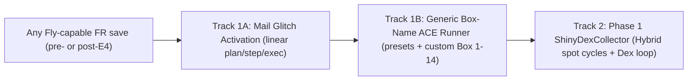

# FRLG Mail Glitch, ACE Runner & Phase 1 Shiny Dex Collection — Design & Work Plan

This document specifies the design, architecture, and phased PR plan for an automated FireRed Shiny Dex Collector (initially Phase 1: Kanto FireRed exclusives, caught in Luxury Balls via Wild RNG + Game Corner Gift RNG) and its two decoupled prerequisite programs (Mail Glitch Activation and Generic Box-Name ACE Runner), all built on top of `frlg/lean`.

Phase 2 (Sevii Islands FireRed exclusives: Wooper, Qwilfish, Delibird, Murkrow, Skarmory) is intentionally parked for a later phase once Sevii Island map/ferry travel is added.

---

## 1. Core Architectural Decision: Adopting `plan / step / execution`

`frlg/lean` provides a mature shared story stack (`SerialPrograms/Source/Pokemon/AutoStory/`, `pokesim-authored-checkpoint/1`, `StoryRunOptions`, `OverworldMaps`, `OverworldSim`, `AutoStoryPcStorage`, `FlyMap`, `FieldMoveUsers`, `NamingScreenKeyboard`, and `Pokemon_StoryRngHandoff`). Every overworld leg, save, heal, PC transfer, and RNG handoff (`01.01`, `01.05`, `04.02`, `09.03`, `16.03b`) is authored as JSON checkpoints and verified offline in the simulator.

All three programs live as separate programs on top of `frlg/lean` and adopt the `plan / step / execution` stack where it fits best:

| Track / Program | Structure | Starting State | Output State |
|---|---|---|---|
| **Track 1A: Mail Glitch Activation** | Pure linear `pokesim-authored-checkpoint/1` plan on `StoryEngine` (with `StoryRunOptions` start/end dropdowns) | Any outdoor Fly-capable save with Celadon + Vermilion unlocked (**pluggable pre-E4 or post-E4**) | Save with CH'DING, MIMIEN, Retro Mail glitch executed, and ACE bootstrap species (`0x085F` / bootstrap) ready |
| **Track 1B: Generic Box-Name ACE Runner** | Standalone PC/menu utility (named presets + custom Box 1–14 strings), callable as a `game_action` if needed | Save with ACE bootstrap species ready | Executes validated Box 1–14 payload with pre-save & postcondition checks (Phase 1 prep presets grant Master Balls, Luxury Balls, Rare Candies, Max Repels, Escape Ropes, Coins/Money, Lv. 100 Parasect + HM/Sweet Scent team) |
| **Track 2: Phase 1 Shiny Dex Collector** | **Hybrid**: authored 2-checkpoint `pokesim-authored-checkpoint/1` spot cycles (`<spot>.arrive` + `<spot>.post_catch`) driven by an outer Dex Loop Orchestrator | Prepped save meeting the party/bag/SID contract | All 13 Kanto FireRed-exclusive shinies (default preset, editable) caught in Luxury Balls (+ Game Corner Scyther) and deposited into the shiny PC box(es) |

### Why Dex Collection uses a Hybrid (not a pure flat AutoStory table)

A flat static table breaks down on two Dex-specific needs:
1. **Multi-catch repetition at the same spot**: Route 8 needs 4 shinies (2 Ekans + 2 Growlithe) from the same tile; Route 7 needs 3 Oddish; Viridian Surf needs 2 Psyduck. Authoring 13 copy-pasted `.plan.json` files is noisy and brittle.
2. **Dynamic target & stage eligibility**: On shared routes (Route 8: Ekans + Growlithe) or multi-stage routes (future Route 12: Oddish + Gloom), the Wild Target Searcher should pick whichever *currently still-needed* species/stage has the fastest unused `(seed, advance)`—which cannot be hardcoded into static checkpoints.

With the **Hybrid** layout:
- **Inside each spot**: authored 2-checkpoint `pokesim-authored-checkpoint/1` cycles (`<spot>.arrive` + `<spot>.post_catch`) reuse `OverworldSim` route verification, wanderer avoidance, postconditions, retry-from-save, `Pokemon::rng_handoff_mode` (`STOP` vs `RUN`), and dev-file hot reload.
- **Outside the spots**: a small, unit-tested **Dex Loop Orchestrator** tracks remaining evolution-line quotas, excludes used `(seed, advance)` pairs (preventing clones), picks the next spot with unsatisfied demand, and loops `<spot>.arrive -> RNG handoff -> <spot>.post_catch` until that spot's quota reaches zero.

**Build order:** Track 1 (Mail Glitch Activation + Generic Box-Name ACE Runner) first so we can auto-prep a fresh save end-to-end, followed by Track 2 (Phase 1 `ShinyDexCollector`).

---

## 2. Track 1A — Mail Glitch Activation (`plan / step / execution`)

### Minimal Prerequisites
Starts from **any outdoor Fly-capable FireRed save** with Celadon City and Vermilion City unlocked, making it pluggable either pre-Elite Four or post-Elite Four.

### Linear Checkpoint Flow
Split into prep checkpoints + glitch checkpoints inside one `pokesim-authored-checkpoint/1` plan so the user can run end-to-end or resume from any checkpoint via `StoryRunOptions`:

1. **Acquire Abra (deterministic)**: Fly to Celadon City → buy Coins (if needed) → enter `CeladonCity_GameCorner_PrizeRoom` → redeem Abra (180 Coins) → save. *(Reuses `CeladonCity_GameCorner_PrizeRoom`, which Track 2 also uses for Scyther.)*
2. **Acquire Spearow**: Fly to Route 4 or Viridian City (Route 22) → catch Spearow via existing `AutoStoryCapture` → save.
3. **Trade for CH'DING (Farfetch'd)**: Fly to Vermilion City → enter `VermilionCity_House1` → trade Spearow for CH'DING → save.
4. **Trade for MIMIEN (Mr. Mime)**: Fly to Pewter City / Vermilion City → reach `Route2_House` (via Cut or Diglett's Cave) → trade Abra for MIMIEN → save.
5. **Buy Retro Mail & stage party/PC**: Buy Retro Mail (verify exact FRLG Switch shop/location against `pokefirered` decomp when authoring) → organize required party/PC slots via `AutoStoryPcStorage` → save.
6. **Execute Mail Glitch & spawn ACE bootstrap**: Run the deterministic PC/Party Mail Glitch sequence (`game_action`s) → verify bootstrap species (`0x085F` / expected bootstrap state) → save.

### New Maps & Actions Needed
- Maps to add to `PokemonFRLG_OverworldMaps.cpp` + map pack:
  - `CeladonCity_GameCorner_PrizeRoom`
  - `VermilionCity_House1`
  - `Route2_House`
  - Plus connector/shop maps as needed (`DiglettsCave` if approaching Route 2 east from Vermilion rather than Cut from Pewter; `CeladonCity_DepartmentStore_2F` if Retro Mail is purchased there).
- Bespoke `game_action`s: NPC trade, give/take Mail, Mail Glitch trigger + bootstrap verification.

---

## 3. Track 1B — Generic Box-Name ACE Runner

### Interface & Built-In Presets
- Exposes both **named presets** and **custom Box 1–14 string inputs**.
- Reuses `PokemonFRLG_NamingScreenKeyboard` (already matching Switch `REVISION >= 0xA` with `NamingScreenKind::BOX`) and `AutoStoryPcStorage`.
- Initial presets for English FireRed Switch (`REVISION >= 0xA`):
  1. **Phase 1 Bag Prep**: Stock Balls pocket **Slot 1 = Master Balls** (calibration) and **Slot 2 = Luxury Balls** (shinies), **Rare Candies** (top of Items pocket), **Max Repels**, **Escape Ropes**, and **Coins / Money** (Game Corner Scyther).
  2. **Phase 1 Party Prep**: Configure **Slot 1 = Lv. 100 Parasect** (252 Speed EVs, Move 1 = Spore, Move 2 = False Swipe, holding Lum Berry / Leftovers) + Fly/Surf + **Sweet Scent** (last occupied slot, no other field moves).
- Exact Switch `REVISION >= 0xA` box-name payloads will be verified against FRLG Switch memory layout before shipping presets.

### Mandatory Safety Guardrails
1. **Pre-save** in the overworld before entering the PC.
2. **Pre-validate** every character and length of all non-empty Box 1–14 strings via `naming_text_error(..., NamingScreenKind::BOX)` before sending any controller input.
3. **Type & confirm** each box name via `PokemonFRLG_NamingScreenKeyboard` + `AutoStoryPcStorage`, verifying box cursor/screen transitions.
4. **Trigger ACE** cleanly.
5. **Postcondition verification** before saving again (confirm the game is responsive in overworld/menu and the expected item/party/money change took effect; on mismatch, stop *without* saving so the pre-save remains untouched).

---

## 4. Track 2 — Phase 1 Shiny Dex Collector (`ShinyDexCollector`)

### 4.1 Starting Precondition Contract
Validated up front before moving (following `RngProgramInstance::run_precheck` + `AutoStory`):
- **Party**:
  - **Slot 1**: Lv. 100 **Parasect** (252 Speed EVs, Move 1 = **Spore**, Move 2 = **False Swipe**, holding Lum Berry / Leftovers).
  - **Fly & Surf users**: auto-tracked via `frlg/lean`'s `FieldMoveUsers` (`FIELD_MOVE_USERS`).
  - **Last occupied slot**: **Sweet Scent** user with **no other field moves**, keeping `BlindNavigation::use_sweet_scent` timings untouched.
  - **Free slots**: at least **1 free party slot** (`WildRng` and `GiftRng` each require 1 free slot; `EggRng` is the only RNG program requiring 2–3).
- **Balls pocket (2-slot layout)**:
  - **Slot 1**: **Master Ball** — instant 1-turn calibration catches, always restored on reset.
  - **Slot 2**: **Luxury Ball** — thrown by Parasect after Spore + False Swipe on shinies.
- **Bag & Key Items**:
  - **Rare Candies** at top of Items pocket (calibration refinement; resets always restore them).
  - **Max Repels** and **Escape Ropes** (Power Plant transit & exit).
  - **Super Rod** registered to Select (`BUTTON_MINUS`).
  - **5,500+ Coins** (or money) for Game Corner Scyther.
- **Trainer Info**: **TID** (auto-read from Trainer Card or typed) and **SID**.

### 4.2 Targets, Evolution-Line Demand, Clones & Off-Target Shinies

#### Default Preset: Kanto FireRed Exclusives (13 shinies, per-line editable)
| Spot ID | Hub / Route | Maps on `frlg/lean` | Encounter / Handoff | Eligible Species | Default Count |
|---|---|---|---|---|---|
| `route8` | `LavenderTown` → `Route8` | **Existing** | `wild_rng` (`grass`) | `ekans`, `growlithe` | Ekans 2, Growlithe 2 |
| `route7` | `CeladonCity` → `Route7` | **Existing** | `wild_rng` (`grass`) | `oddish` | Oddish 3 |
| `viridian_surf` | `ViridianCity` pond | **Existing** | `wild_rng` (`surfing`, 100%) | `psyduck` | Psyduck 2 |
| `vermilion_rod` | `VermilionCity` shore | **Existing** | `wild_rng` (`superrod`, 40%) | `shellder` | Shellder 2 |
| `power_plant` | `Route10` → `PowerPlant` | `Route10` existing; **add `PowerPlant`** | `wild_rng` (`grass`, 5%) | `electabuzz` | Electabuzz 1 |
| `celadon_prize` | `CeladonCity` → `PrizeRoom` | Added in **Track 1A** | `gift_rng` (`gamecornerscyther`) | `scyther` | Scyther 1 |

Only **1 additional map** (`PowerPlant`) is needed in Track 2 beyond Track 1A (and `PowerPlant` is already listed in `PokemonFRLG_SaveCardReader.cpp`). Route 7 is used for Oddish so no Route 12–15 maps are required in Phase 1.

#### Evolution-Line Flexibility (`PokemonFRLG_DexDemand`)
- Model each evolution line as ordered stages (e.g., `oddish -> gloom -> vileplume / bellossom`) with per-slot target counts.
- A catch of species `S` satisfies any unfilled slot for `S` or any descendant of `S` (preferring the highest descendant slot first so lower-stage slots stay protected when higher stages are caught on multi-stage routes).
- Expose `eligible_species_at(location_slots) -> std::set<std::string>` so shared routes (`Route8`: Ekans + Growlithe) and future multi-stage routes consider **all** currently useful species/stages in a single target search.

#### Clone Prevention & Off-Target Shinies
- **No clones**: Every caught shiny records `(location, encounter_type, seed, advance)` into `used_targets` and excludes it from subsequent searches so copies of the same species have distinct PIDs/IVs.
- **Off-target shinies**: On any shiny encounter, read the wild species via `WildEncounterReader`:
  - If still needed by any line quota → catch in Luxury Ball, save, deposit, and decrement that line's quota.
  - If unneeded (e.g., shiny Pidgey on Route 8) → catch in Luxury Ball, save, and deposit as a bonus shiny by default, with an optional checkbox to ignore/reset instead.

### 4.3 Authored Spot Cycles & Execution Schema
Extend `PokemonFRLG_AutoStoryTable.cpp`'s `execution` object minimally (matching existing `"handoff": "gift_rng", "gift": "eevee"` / `"lapras"`):
- Add `StoryHandoff::WILD_RNG` (`"handoff": "wild_rng"`)
- Add optional `"wild": {"location": "<loc_slug>", "encounter": "grass|surfing|superrod"}`
- Add `"gamecornerscyther"` to `read_gift()` (already accepted by `GiftRngConsoleSettings::target` on `frlg/lean`!)

Each spot is a 2-checkpoint cycle (`DexData/*.plan.json`):
1. **`<spot>.arrive`** (`execution.handoff = "wild_rng"` or `"gift_rng"`):
   - Fly to hub town → enter Center → heal (restores Spore / False Swipe / Sweet Scent PP) → `pc` deposit Slot 5 `if_present: true` → walk/surf/face water to exact encounter tile → **save**.
2. **`<spot>.post_catch`** (`execution.live_start = true`):
   - **Save immediately** (on the encounter tile, or after `leave_gift_summary` for Game Corner Scyther) so transit issues can never lose the shiny → Escape Rope if indoors (`PowerPlant`) → Fly to hub Center → heal → `pc` deposit Slot 5 into the configured target shiny box (**auto-advancing to the next box when full**, defaulting away from Box 1 / ACE boxes) → **save**.

### 4.4 Callable Wild RNG, Parasect Catcher, Target Search & Persistence

Following the exact handoff pattern established in FRLG (`GiftRngAttempts` + `ConsoleGiftRngSteps` + `CalibrationSavingSteps`) and BDSP (`run_starter_rng_attempts` + `settled` contract + `Pokemon::rng_handoff_mode`):

1. **`PokemonFRLG_WildRngAttempts` + `PokemonFRLG_WildRngConsoleSteps`**:
   - Extract the reset/calibrate/catch/read/Rare-Candy loop from `WildRng::program()` so standalone `WildRng` and `ShinyDexCollector` share one implementation.
   - Support `Pokemon::rng_handoff_mode` (`STOP` vs `RUN`) and `CalibrationSavingSteps` so learned `SEED`, `CSF`, and per-encounter-type `INGAME` offsets persist across hunts and restarts.
   - Post-shiny **settled contract**: return `shiny_caught` (with `caught_species` and `settled = true`) only once `exit_battle_after_catch()` confirms overworld control. If the catch fails (e.g., early-wake Roar or balls exhausted), nothing was saved—reset and retry cleanly.
   - Also plumb optional `max_rare_candies` through `GiftRngConsoleSettings` for Game Corner Scyther calibration.

2. **`catch_shiny_parasect()`**:
   - Turn 1: Move 1 (**Spore**) — Lv. 100 Parasect (252 Speed EVs) outspeeds Lv. 18 Growlithe (beats Roar) and Lv. 35 Electabuzz.
   - Turn 2: Move 2 (**False Swipe**) → 1 HP.
   - Turn 3+: Select Balls pocket Slot 2 (**Luxury Ball**) and throw.
     - Ekans (R=255), Oddish (R=255), Psyduck (R=190), Growlithe (R=190), and Shellder (R=190) are **100% guaranteed catch on Luxury Ball #1** at 1 HP + Sleep (`a >= 255`).
     - Electabuzz (R=45): ~36% per Luxury Ball at 1 HP + Sleep (~3 balls avg); Parasect resists Electric, Lum Berry handles Static paralysis, and re-Spore on wake keeps it safe.
   - During calibration resets (non-shiny), use existing `auto_catch(..., 1)` on Balls pocket **Slot 1 (Master Ball)** for guaranteed 1-turn catches (restored on reset).

3. **Wild Target Search (`PokemonFRLG_RngTargetSearch` / `PokemonFRLG_RngPlan`)**:
   - Add `search_wild_rng_targets()` over `SeedsDatabase` (filtered by `sound`, `"Help"` button mode, safe seed delay `>= 31500ms`) + `AdvRngWildSearcher` + `EncountersDatabase`.
   - Default search: **fastest shiny frame on Method 1 without Teachy TV**, with optional Nature/IV filters and Method 2/4 fallback if needed.
   - Matches any species in `eligible_species`, excludes `(seed, advance)` in `used_targets`, and respects `min_advances + ingame_margin` for `BlindNavigation`.

4. **Progress Persistence**:
   - Persist remaining line counts, caught log, and `used_targets` in a small JSON file under `USER_FILE_PATH()` (editable and resettable).
   - Persist `RngStopCalibrationOptions` and `FieldMoveUsers` in program `ConfigOption`s, matching `AutoStory`.

---

## 5. Verification & PR Breakdown (on top of `frlg/lean`)

All PRs follow `frlg/lean`'s unit-test-first bar (`--command-line-test-mode` with separate `*_Tests.{h,cpp}` files, no inline tests in production `.cpp`, CRLF/LF preserved, zero tabs, `/W4 /WX` clean):

### Track 1 (Build First)
1. **PR 1 — Mail Glitch Activation maps + `plan / step / execution` checkpoints**:
   - Add `CeladonCity_GameCorner_PrizeRoom`, `VermilionCity_House1`, `Route2_House` (+ connector/shop maps as needed), trade/mail/glitch `game_action`s, `OverworldSim` walk/postcondition tests, and live console verification.
2. **PR 2 — Generic Box-Name ACE Runner**:
   - Box-renaming driver over `NamingScreenKeyboard` + `AutoStoryPcStorage`, pre-save / character validation / postcondition safety guardrails, unit tests against a fake PC, and verified Switch `REVISION >= 0xA` Phase 1 prep presets.

### Track 2 (Build Next)
3. **PR 3 — Callable `WildRngAttempts` + `ConsoleWildRngSteps` + `catch_shiny_parasect`**:
   - Refactor standalone `WildRng` cleanly with unit tests and zero regression to standalone `WildRng`.
4. **PR 4 — Wild `RngTargetSearch` + `DexDemand` + `DexProgress`**:
   - Pure unit tests for evolution-line fulfillment, clone exclusion, JSON progress save/load, and Method 1 wild shiny target search against `EncounterSlotsFR.json`.
5. **PR 5 — `PowerPlant` map + `ShinyDexCollector` + 6 Spot Cycles**:
   - Full-loop unit tests against `StoryFakeBackend` + fake `StarterRngLoopSteps` (covering shiny hit, off-target eligible shiny, bonus shiny vs ignore, Roar retry, `STOP` handoff, box auto-advance, and resume), `OverworldSim` tests for all 6 spots, and live console verification (Route 8 multi-catch first, then remaining 5 spots).
