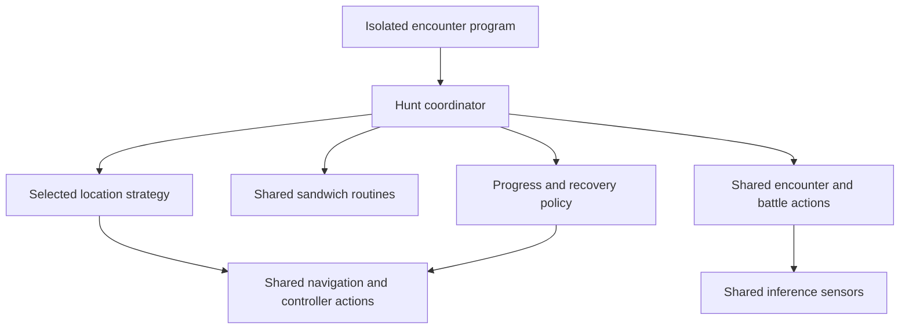

# Isolated encounters in Scarlet/Violet: analysis and staged plan

Date: 2026-10-23 PDT. Owner: Codex for research and prospective lab work;
existing PR ownership remains as defined in AGENTS.md. Status: **research
complete for an initial Paldea pass; field validation and implementation have
not started**. This plan does not change the approved BBQ roadmap's priority
or consume Switch time. M8a's separate worktree is retained.

## 1. Recommendation and scope

Build a catalog of **validated hunting spots and reusable movement primitives**,
then implement one spot. Do not begin with automatic navigation for every species
or a general overworld shiny classifier. First establish that specific spots
produce repeatable, reachable encounters at a useful rate.

The first field candidates are Mareep at Cortondo, Oricorio at Artazon and Kirlia
at Levincia. They exercise short boundary crossings with progressively different
geometry. Larvesta in Asado is the first comparison for a riding loop. These are
research priorities, not implemented or field-certified hunts. A high-coverage
western Paldea cell (table 97) is a parallel scouting candidate, not a substitute for
the demonstrated Levincia Kirlia location.

Initial scope: single-player Paldea, both game versions, one family represented
by at least one obtainable species. Keep forms, gender-dependent evolutions,
time conditions and version exclusivity explicit. Kitakami and the Terarium
need separate analyses and must not be included in Paldea totals.

Deliverable for the next stage: a small set of exact, photographed anchors,
named flight points, approach measurements, reset observations and encounter
acquisition results. Only then choose the first feature implementation.

## 2. What has been done and how much is covered

The [research report](REPORT.md) and [summary](summary.json) contain the initial
extraction. Inputs are the [Alexis Matuk optimizer][A], the author's served
JavaScript tables, [PokeAPI's species/evolution-chain data][P], and the fly
markers embedded in [Serebii's Paldea map][S]. Source URLs and SHA-256 hashes
are recorded in [source_manifest.json](source_manifest.json).

| Measure | Scarlet | Violet |
| --- | ---: | ---: |
| Species with a nonempty optimizer record | 327 | 327 |
| Evolution families represented | 179 | 179 |
| Species with score 100 at some table/type | 119 | 117 |
| Families represented by such species | 94 | 93 |
| Families with a same-type pool containing only that family, allowing multiple evolution stages | 98 | 97 |

A family is a PokeAPI evolution chain, so Gardevoir and Gallade share a family;
Paradox species do not get merged with the species they resemble. Getting one
family representative does not establish availability of all its evolutions,
forms or genders. A living shiny dex and one-representative-per-family are
different coverage objectives.

The extraction includes 325 table IDs per version, 31,437 species/type/table
rows in total, and 68 ordinary flight/PC markers. The extracted score-100 set
matches the author's separate type_success tables exactly: 880 Scarlet rows
and 842 Violet rows, zero tuple differences. This validates extraction against
the author's published data; it does not independently validate game mechanics.

Coverage by type is in [coverage_by_type.csv](coverage_by_type.csv), including
family names. Representative strict-family counts:

| Sandwich type | Scarlet | Violet |
| --- | ---: | ---: |
| Psychic | 12 | 10 |
| Poison | 8 | 9 |
| Dragon | 8 | 8 |
| Steel | 7 | 8 |
| Electric | 8 | 7 |
| Fairy | 6 | 7 |
| Fire | 5 | 6 |
| Water | 1 | 2 |

See REPORT.md for all 18 types and the family-pool extension. Types overlap:
a dual-type family can count in more than one column. These numbers must not
be added into a coverage total. Psychic's larger count is not evidence that
its routes are easier or faster than Fire routes.

### What an optimizer score means

The newer [Edward Simmons implementation][E] computes its displayed value as
`floor(100 / number of same-type species in the selected pool)`, with special
handling for version-exclusive tables. This is a pool-size proxy. It does not
model actual encounter weights, available spawn positions, pack sizes, encounter
power mechanics, weather, time or competing fixed encounters. We use the older
Alexis precomputed score as an author-provided score, not an actual probability.

Three coverage levels must stay separate:

1. **Data candidate:** a species/family has a promising pool record.
2. **Field-supported spot:** its exact habitat and reset loop produce the
   expected family under recorded conditions.
3. **Automated coverage:** the program reaches, refreshes and handles encounters
   there with bounded recovery, including suspected-shiny handling.

There are currently zero newly field-validated or automated spots in this
investigation. The counts above are candidate coverage, not program promises.
They are also not an upper bound: a narrow microhabitat can work even when the
broader table has several competing species.

## 3. Distance, terrain and spatial uncertainty

### Calculated access proxy

[Candidate rows](candidate_cells.csv.gz) and the smaller
[strict subset](strict_candidates.csv) join table markers to the nearest
ordinary fly marker. Each row retains both sets of coordinates and distance:

`d = sqrt((table_x - fly_x)^2 + (table_z - fly_z)^2)`

For a typical 250-by-250 cell, marker-to-spot uncertainty can be up to half its
diagonal, approximately 176.8 map units. The reported low/high interval accounts
only for that positional uncertainty. It is not a route-length confidence
interval. Distances are in map units and grid widths, not calibrated metres.

A cell whose centre is only 0.08 grid widths from a fly marker might still put
the desired habitat across a cliff or outside the accessible side of town.
The nearest point geometrically may not be the fastest usable flight point.

The source's ordinary marker elevation is the constant 27, so it cannot provide
slope. Area Zero IDs 828/829/830 use a common placeholder; their access distance
fields are blank. Shrine fly markers are excluded because their availability
has extra conditions. The 68 included ordinary points are not an assertion
that every point is unlocked or that the source lists every current fly point.

### What the distance data can prioritize

Examples for Violet, across separate sandwich types:

| Table | Families with score-100 representatives | Centre-to-nearest-fly distance |
| --- | ---: | ---: |
| 206, (2875,1875) | 8 | 0.63 grid widths |
| 197, (3625,3625) | 7 | 0.46 grid widths |
| 97, (625,2375) | 6 | 0.08 grid widths |
| 451, (1125,2625) | 6 | 0.44 grid widths |

Table 97's candidates are Charcadet/Fire, Kirlia/Fairy, Lokix/Bug, Nacli/Rock,
Varoom/Steel and Cyclizar/Dragon. This could make an efficient scouting visit
if their usable habitats are nearby. It is not the Levincia stairs demonstration.
The source marker alone does not establish one common anchor or loop for them.

The [greedy cell shortlist](data_first_shortlist.csv) reaches 42 distinct Violet
families in eight cells whose centres are within one grid width of an ordinary
fly marker. Selection maximizes new family coverage, with distance breaking
ties. It ignores terrain, target acquisition and actual approach. It is useful
for scouting breadth, not for selecting the first automation implementation.

### Terrain records to collect

For each exact spot, record these observations separately rather than combining
them into an invented numerical flatness score:

| Dimension | Record |
| --- | --- |
| Surface | paved, grass, sand, rock, water; transitions along loop |
| Elevation | level, gentle slope, stairs, ramp, climb or drop |
| Constraints | wall/fence/road edge usable as an anchor; width available |
| Hazards | cliff/water edges, ledges, obstacles, unwanted interactions |
| Visibility | grass height, shadows, occlusion, day/night, model size |
| Camera | fixed view sufficient, periodic recenter, continuous panning |
| Motion | walking/riding; heading changes; loop duration and drift |
| Recovery | known fly point, reliable landing orientation, approach cost |

Until measured in-game, terrain assessments in video_candidates.csv are visual
inferences from selected video frames, not complete geometry or navigation maps.

## 4. Video evidence and candidate ranking

Both linked videos were retrieved with captions and 480p video. Caption text
and selected timestamped frames were reviewed. Full transcripts/videos remain
in local research cache; this repository stores paraphrased notes, references
and frame sheets. No claim is made of continuous frame-by-frame viewing.

The practical ranking is based on expected control simplicity and recovery,
not estimated shiny probability. [video_candidates.csv](video_candidates.csv)
records the evidence and deliberately leaves unmeasured distance/time blank.

| Priority | Family / type | Place | Control pattern | Assessment |
| --- | --- | --- | --- | --- |
| 1 | Mareep / Electric | Cortondo PC edge | short boundary crossing | grounded, nearby anchor |
| 2 | Oricorio / Fire | Artazon edge | short boundary crossing | small motion; mixed competitors |
| 3 | Ralts via Kirlia / Fairy | Levincia stairs | boundary crossing on stairs | constrained path; occlusion |
| 4 | Fidough via Dachsbun / Fairy | Alfornada edge | curved-boundary crossing | mixed Sylveon; line harder |
| 5 | Larvesta / Fire | Asado Desert | riding loop | dunes and drift |
| 6 | Litleo via Pyroar / Fire | south of Glaseado | rock loop | slope/ledge access |
| 7 | Wattrel / Flying or Electric | North Lighthouse shore | beach loop | water, rocks, time-sensitive posture |
| 8 | Iron Hands / Fighting or Electric | Area Zero station 4 | waypoint lap | ramps, drop, camera, aggression |

Sources: Austin John Plays, [33 EASY Shiny Hunts][V2], at
[Mareep 10:24](https://www.youtube.com/watch?v=wP2rClXrn3A&t=624s),
[Oricorio 4:45](https://www.youtube.com/watch?v=wP2rClXrn3A&t=285s),
[Kirlia 25:38](https://www.youtube.com/watch?v=wP2rClXrn3A&t=1538s),
[Dachsbun 27:34](https://www.youtube.com/watch?v=wP2rClXrn3A&t=1654s),
[Larvesta 2:40](https://www.youtube.com/watch?v=wP2rClXrn3A&t=160s),
[Pyroar 5:32](https://www.youtube.com/watch?v=wP2rClXrn3A&t=332s),
[Wattrel 11:17](https://www.youtube.com/watch?v=wP2rClXrn3A&t=677s), and
[Area Zero lap 14:23](https://www.youtube.com/watch?v=wP2rClXrn3A&t=863s).

The initial [isolated encounter video at 13:24][V1D] shows habitat selection
for Donphan/Phanpy. The creator compares about 9s riding refresh with 16.5s
picnic repopulation; inspection time differs. This motivates comparing refresh
methods, not a claim of a measured bot speedup or expected shiny rate.

Frame evidence: [boundary examples](boundaries-contact.jpg),
[riding examples](routes-contact.jpg), [Donphan examples](donphan-contact.jpg).

### How to interpret the examples

- A microspot and a broad cell can disagree. Oricorio's best older-optimizer
  score is 33, while the video demonstrates a small Artazon boundary loop.
  Keep that loop as a promising demonstrated candidate; do not upgrade its
  whole-cell score or assert a pure Oricorio pool. The video also mentions
  Charcadet there.
- The comparison should include both reset classes. A boundary loop may be
  simplest to control, but a riding route may expose more eligible targets.
- Access ranking and hunting ranking are separate. Once a long session starts,
  small approach savings matter less than repeatable target encounters and
  reliable recovery. A nearby fly point matters more if resets are frequent.

## 5. Codebase pieces and dependency direction

Survey basis: local code checkout `c69b5d0954128d5c413819b49e4a1c37f019d6f7`.
Paths below are under `SerialPrograms/Source/VideoGames/PokemonSV`.
Recheck current shared APIs before implementing; this is an inventory, not a
claim that each existing routine already has the required contract.

| Responsibility | Existing component | Reuse / remaining work |
| --- | --- | --- |
| Complete example | [Scatterbug hunter][C1] | Closest example of sandwich, traversal, healing, encounters and save/reset orchestration; location-specific logic is embedded |
| Alternative complete example | [Area Zero platform hunter][C2] | State transitions, low-progress recovery, platform traversal and session tracking; platform geometry is specific |
| Food | [Sandwich routines][C3] and SandwichMakerOption | Shared recipe/ingredient actions; choose an appropriate preset and verify the resulting setup |
| Clearing / progress | [Let’s Go tools][C4] | Kill tracking, active-time windows and movement wrapped with clearing; new route still required |
| Continuous signals | [OverworldSensors][C5] | HP, kill, battle-entry and shiny-audio tracking; not a general overworld shiny classifier |
| Battle decisions | [Battle routines][C6], EncounterBotCommonOptions | Species reads, shiny battle assessment, stop/flee/catch/save policy |
| Access / recovery | [World navigation][C7], MenuNavigation, GameEntry, SaveGame | Fly/menu/save/reset building blocks; exact destination and bounded location recovery still need profiles |
| Operating framework | SingleSwitchProgram, stats, notifications, inference sessions | Existing program plumbing; add the coordinator rather than a parallel framework |

Proposed direction:

A strategy may expose bounded prepare, reset, acquire-target and recover actions.
This is a proposed boundary, not a commitment to a large interface hierarchy.
Start with one consumer and the smallest useful seam. Top-level programs should
not call each other. Extract unchanged common behavior separately from new
hunting behavior when practical; preserve existing hunters' defaults.

Existing navigation code needs a bounds/cancellation audit before reuse. The
BBQ investigation already found long or nested recovery loops; a shared routine
is not automatically bounded just because its caller has a timeout. Confirm
that the controller context deadline propagates through nested actions and that
broad exception handlers do not swallow cancellation. Any shared repair belongs
in a focused prerequisite change, coordinated with its current PR owner.

The external location catalog should inform curated C++ profiles. A first bot
should not depend on live web scraping or run a web optimizer during a hunt.

### The main feasibility gate: encounter acquisition

The videos largely depend on human visual inspection. Refreshing spawns does
not automatically let the bot identify or approach a shiny. The existing battle
pipeline assesses an entered encounter; it does not scan every visible Pokémon.

Evaluate two possible acquisition approaches in the field:

1. Existing Let’s Go clearing/progress, with a bounded investigation/encounter
   step when clearing stalls or an existing bubble trigger fires. A stall or
   bubble is not shiny proof; require battle confirmation. False triggers and
   unreachable targets need measurement.
2. A bounded route that deliberately enters battles and uses existing
   species/shiny checks. This may be slower but gives an explicit verification
   point. Unreachable or airborne targets can still make it unsuitable.

A visually appealing picnic/boundary spot could fail both approaches. Keep it
as a human-assisted reset helper rather than calling it an autonomous hunter.
General overworld shiny vision remains separate research unless acquisition
experiments show it is required for the chosen objective.

## 6. Stages, outputs and acceptance gates

The following are proposed research/engineering gates, not completed results.
Switch work is scheduled separately and must have one controller owner.

### Stage 0 — reproducible data baseline: completed

Retain source hashes, raw-source URLs, normalization rules, extraction code,
coverage outputs, distance uncertainty and the independent strict-set check.
Re-run when source data changes. Do not silently mix data vintages or regions.

### Stage 1 — exact spot cards: next

Start with Cortondo Mareep and Artazon Oricorio; inspect Levincia Kirlia next.
For diversity, include Asado Larvesta before expanding to many boundary profiles.

For each spot card record:

- game/version and tested hardware; sandwich type/power; time/weather;
- exact fly-point name and required unlocks/ride abilities;
- map screenshot, nearby coarse table ID, standing/camera screenshot;
- approach steps, elapsed time, horizontal-distance estimate and confidence;
- terrain fields from section 3, reset steps, visible anchor and recovery;
- demonstrated and observed species, family identity and competitors;
- dated video/field evidence, unresolved assumptions and proposed action bounds.

Use a real distance measurement only when the game's marker, calibrated map or
another recorded method supports it. Otherwise record steps/time and mark
metres unknown. Retain both estimated and measured values; do not overwrite a
proxy with a measurement of a different spot.

Gate: another operator can reach the same spot and perform the reset from the
card without interpreting a vague area name. No long automated run yet.

### Stage 2 — brief field screening

For each first-round candidate, record five independent approaches and at least
ten reset cycles under the same stated conditions. These are screening sample
sizes, not statistical reliability certification. Count failures and recovery,
not just the best run. Obtain field footage where the spawn change is visible.

Measure:

- approach time from the named fly point, excluding/including loading separately;
- reset duration and confirmed new eligible spawns, not repeated sightings;
- target-family fraction, pack behavior and competitor encounters;
- target acquisition attempts, entered battles and species confirmations;
- drift, unwanted menu interactions, clipping, water/cliff incidents;
- HP changes, stalls and time to return to a known anchor.

Gate: the spot has a repeatable reset and at least one plausible bounded
acquisition method. Promote at most two complementary candidates: a boundary
profile and a riding profile if the latter is competitive. Defer candidates
requiring speculative new vision or unbounded navigation.

### Stage 3 — choose and implement one vertical slice

Use a dedicated worktree and the existing lab workflow. The first slice starts
at a prepared, documented anchor. Automatic sandwich preparation and approach
can initially remain manual while the encounter loop is proven; their status
must be explicit in the UI/run record. Build all new behavior into one coherent
candidate, with native C++ tests through production action seams.

First slice behavior:

1. Verify the required overworld/anchor state and setup.
2. Run one bounded refresh/movement cycle under continuous encounter monitoring.
3. Perform the chosen bounded acquisition action; handle confirmed battles via
   the existing battle pipeline.
4. Re-establish the anchor after an encounter or report recovery exhaustion.
5. Stop on configured completion, suspected-shiny handoff policy, or exhausted
   recovery; never keep resetting while an unresolved encounter needs handling.

Native cases should cover success, unexpected battle, false stall/bubble signal,
no target, boundary not crossed, camera/anchor loss, acquisition timeout,
recovery exhaustion, cancellation, sandwich expiry, and save/reset state after
catching. Keep scripted test code in native test files, not production source.

Gate: full local build and relevant native C++ checks pass; expected failure
paths are bounded and visible. No Python application tests or source-extraction
checks. Python research processing stays on agents.

### Stage 4 — targeted live acceptance, then sustained validation

First test the concrete feature paths in a short controlled session. Preserve
an unsuccessful trial as evidence. Once those work, perform the normal 1–2 hour
validation run from VALIDATION_WORKFLOW.md, using explicit start state, binary
hash, profile, target, lead, sandwich and timestamped checkpoints.

Proposed readiness bar: at least 30 observed completed reset cycles, at least
10 recoveries after actual encounters, no unbounded loop, and no unexplained
loss of the documented location/setup. These counts establish minimum path
exposure, not a probability guarantee. An untriggered rare path remains
unverified; inject controller-independent failures in native tests instead of
pretending one long run proves them.

Report actual eligible battle checks per minute, stalls, wrong-species encounters,
recoveries and active/wall time. No shiny found is not failure of the navigation
slice; finding one is not proof of general reliability.

Gate: the complete reset → acquire → verify → recover loop works, not merely
spawn refresh. Mark a manual-inspection variant as a helper, with different
claims, if autonomous acquisition remains unresolved.

### Stage 5 — compose and expand

Add the second profile using the same coordinator. Extract a common boundary
or riding primitive only when the two actual implementations justify it.
Then add automatic fly/approach, sandwich renewal and longer sessions using
existing components. Validate setup/recovery separately from hunting yield.

Prefer additional profiles that gain new families with little new control
logic. Inspect high-coverage cells as batches, but validate each microhabitat.
Expand region by region; re-run coverage mining for DLC data without treating
new map cells as already navigable.

Release process: feature branches contain code/native tests only. Reports,
settings, footage references and catalogs remain on agents. Open fork drafts
with explicit parents after concrete build/live evidence; Claude owns existing
PR branches and descriptions. No changes to existing PRs are implied here.

## 7. Ranking and ROI after field data exists

Do not invent a weighted score before measuring the fields. Initially rank
lexicographically: confirmed acquisition and bounded recovery first; simpler
motion/grounded targets next; measured yield next; marginal family coverage and
approach cost as additional benefits. Unknown terrain/acquisition cannot be
silently treated as an average score.

For a session, retain:

`wall time = setup + active hunt + encounter handling + recovery + renewal`

Useful measures include:

- confirmed target-family battle checks per wall hour;
- observed fresh target spawns per active minute, reported separately;
- reset failures per attempted reset and recovery cost per completed cycle;
- unique newly supported families per additional location implementation;
- approach duration and number of returns/renewals per session.

Kill count, visible spawn count and shiny-verified encounter count are different
metrics. Do not compare human visual-inspection video throughput with battle
checks as if the detection coverage were equivalent. Do not derive a shiny/hour
forecast from the creators' short lucky runs.

A long approach can be acceptable if amortized over a long reliable hunt. A
short approach is valuable when frequent recovery is necessary. Compare both
against a field-measured baseline, preferably the existing Scatterbug hunter
or a manual route under the same setup, without conflating different targets.

## 8. Remaining decisions and immediate next action

These decisions can be deferred until field evidence answers them:

- Is the initial product a helper that refreshes spawns for a human, or a fully
  autonomous encounter checker? The current plan evaluates autonomous acquisition
  first but labels a useful helper honestly if that is the feasible outcome.
- Is one representative per evolution family sufficient, or are forms/genders
  and a living dex required? Initial coverage uses family representatives.
- Which targets permit a useful ground-based lead and clearing/acquisition
  pattern? Do not assume one lead is appropriate for all profiles.
- Which sandwich powers and material budget should be used for field screening?
  Setup must be recorded consistently; no need to optimize recipes prematurely.

**Next action:** produce exact spot cards and a short measured field comparison
for Mareep/Cortondo and Oricorio/Artazon, then Kirlia/Levincia and Larvesta/Asado.
Re-rank from those observations and choose one implementation. No generic hunt
framework or full-world route work is needed before that decision.

## References and retained evidence

[A]: https://alexis-matuk.github.io/shinyHuntingOptimizer/
[P]: https://github.com/PokeAPI/pokeapi/blob/master/data/v2/csv/pokemon_species.csv
[S]: https://www.serebii.net/pokearth/paldea/
[E]: https://github.com/EdwardSimmons/pokemon-sv-isolated-encounters/blob/8c93e25036e9c27694bec8098ae3a6960edafc78/src/features/map/MapController.tsx
[V2]: https://www.youtube.com/watch?v=wP2rClXrn3A
[V1D]: https://www.youtube.com/watch?v=y9zO9LiFF2Y&t=804s
[C1]: https://github.com/dayfine/Arduino-Source/blob/c69b5d0954128d5c413819b49e4a1c37f019d6f7/SerialPrograms/Source/VideoGames/PokemonSV/Programs/ShinyHunting/PokemonSV_ShinyHunt-Scatterbug.cpp#L312
[C2]: https://github.com/dayfine/Arduino-Source/blob/c69b5d0954128d5c413819b49e4a1c37f019d6f7/SerialPrograms/Source/VideoGames/PokemonSV/Programs/ShinyHunting/PokemonSV_ShinyHunt-AreaZeroPlatform.cpp#L483
[C3]: https://github.com/dayfine/Arduino-Source/blob/c69b5d0954128d5c413819b49e4a1c37f019d6f7/SerialPrograms/Source/VideoGames/PokemonSV/Programs/Sandwiches/PokemonSV_SandwichRoutines.h
[C4]: https://github.com/dayfine/Arduino-Source/blob/c69b5d0954128d5c413819b49e4a1c37f019d6f7/SerialPrograms/Source/VideoGames/PokemonSV/Programs/ShinyHunting/PokemonSV_LetsGoTools.h
[C5]: https://github.com/dayfine/Arduino-Source/blob/c69b5d0954128d5c413819b49e4a1c37f019d6f7/SerialPrograms/Source/VideoGames/PokemonSV/Inference/Overworld/PokemonSV_OverworldSensors.h
[C6]: https://github.com/dayfine/Arduino-Source/blob/c69b5d0954128d5c413819b49e4a1c37f019d6f7/SerialPrograms/Source/VideoGames/PokemonSV/Programs/Battles/PokemonSV_Battles.cpp#L222
[C7]: https://github.com/dayfine/Arduino-Source/blob/c69b5d0954128d5c413819b49e4a1c37f019d6f7/SerialPrograms/Source/VideoGames/PokemonSV/Programs/PokemonSV_WorldNavigation.h

Primary sources: [Alexis optimizer][A]; [Edward source][E]; [PokeAPI taxonomy][P];
[Serebii map][S]; [Austin John Plays examples][V2]; [initial demonstration][V1D].
The linked [sandwich calculator](https://birbzone.com/sandwich/) can support
recipe selection later; no calculated recipe has yet been validated in this
investigation. Machine-readable observations are in video_candidates.csv;
full mining provenance and rerun commands are in REPORT.md and source_manifest.json.
