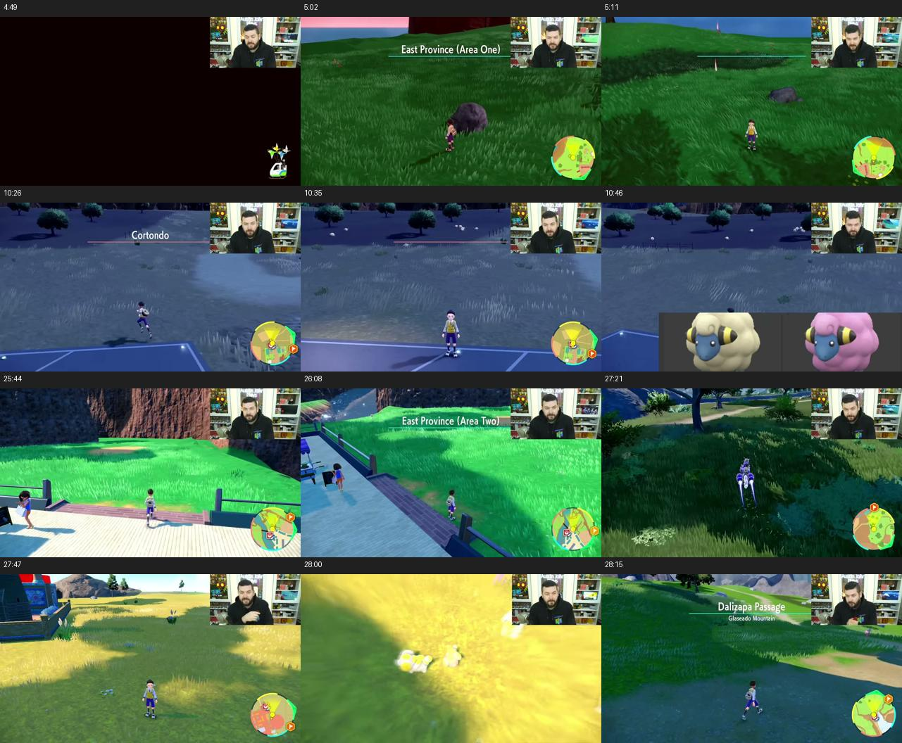
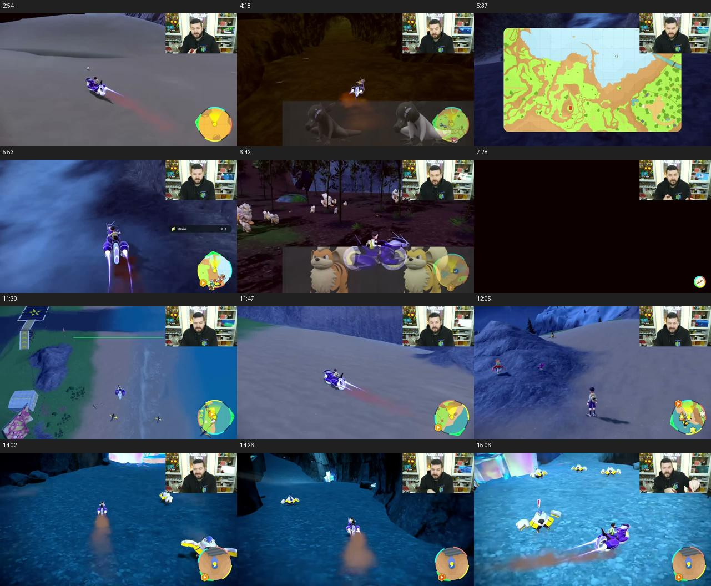
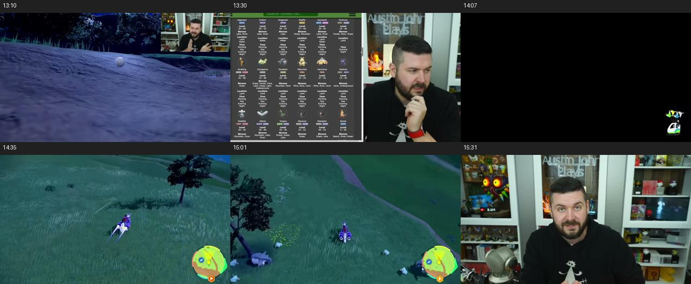

# Isolated-encounter research: Paldea first pass

2026-10-23 PDT. Initial research pass; no live game test. A subsequent supervised
[acquisition prototype](PROTOTYPE_STATE.md) is implemented and its full app build passed.
Both Scarlet and Violet; Paldea only in this pass. Kitakami and Terarium are
not included in these counts. This report separates spawn-table candidates,
creator demonstrations, visual terrain assessment and unmeasured route details.

Detailed design, stages and acceptance gates: [ANALYSIS_AND_PLAN.md](ANALYSIS_AND_PLAN.md).

Follow-up: [24-starter Terarium survey and Charcadet priority](STARTER_SURVEY.md).
It finds 10 local-table isolation candidates, 4 conditional candidates, 9 with
listed competitors and 1 source gap (Mudkip). These are source assessments,
not live results, and do not change the Paldea totals below. Chespin and
Charcadet now lead the field queue; the original video shortlist remains as
comparison evidence.

## What the data supports

Mined the JavaScript tables served by the [Alexis Matuk optimizer](https://alexis-matuk.github.io/shinyHuntingOptimizer/),
joined species to [PokeAPI evolution-chain IDs](https://github.com/PokeAPI/pokeapi/blob/master/data/v2/csv/pokemon_species.csv),
and extracted fly points from [Serebii's Paldea map](https://www.serebii.net/pokearth/paldea/).
Family means one evolution chain: Ralts/Kirlia/Gardevoir/Gallade count once;
Paradox species retain separate chains. Family coverage does not mean every
family member is directly obtainable at the selected spot.

| Metric | Scarlet | Violet |
| --- | ---: | ---: |
| Species with at least one optimizer record | 327 | 327 |
| Represented evolution families | 179 | 179 |
| Species with an author score of 100 somewhere | 119 | 117 |
| Families represented by those species | 94 | 93 |
| Families with an exclusive same-type family pool, allowing multiple evolution stages | 98 | 97 |

The extraction covers 325 table IDs per version, 31,437 species/type/table rows
across both versions, and 68 ordinary fly/PC markers. The 1,722 score-100 rows
exactly match the author's independent `type_success` tables: 880 Scarlet,
842 Violet, zero tuple differences. Source checksums are in source_manifest.json.
The source's duplicate pmarkers definitions are identical; corrupted Flabebe
and alternate Sawsbuck labels are normalized before family grouping.

**These are conditional pool proxies, not measured spawn probabilities or bot
coverage.** The newer Edward Simmons tool explicitly computes its displayed
score as floor(100 / same-type species count); see its
[MapController](https://github.com/EdwardSimmons/pokemon-sv-isolated-encounters/blob/main/src/features/map/MapController.tsx).
Neither that calculation nor the older precomputed score establishes spawn
weights, density, time/weather restrictions, biome boundaries, fixed encounters,
or reliable access. Type totals overlap and must not be added together.

### Coverage by sandwich type

Strict = at least one species scored 100. Family pool = every species in the
listed same-type pool belongs to that family. Neither is a field verification.

| Type | Scarlet strict families | Violet strict families | Scarlet family pools | Violet family pools |
| --- | ---: | ---: | ---: | ---: |
| Bug | 7 | 6 | 7 | 6 |
| Dark | 7 | 7 | 7 | 7 |
| Dragon | 8 | 8 | 9 | 9 |
| Electric | 8 | 7 | 8 | 7 |
| Fairy | 6 | 7 | 6 | 7 |
| Fighting | 5 | 5 | 5 | 5 |
| Fire | 5 | 6 | 6 | 7 |
| Flying | 5 | 6 | 5 | 6 |
| Ghost | 7 | 7 | 7 | 7 |
| Grass | 6 | 5 | 6 | 5 |
| Ground | 6 | 7 | 6 | 7 |
| Ice | 1 | 2 | 2 | 3 |
| Normal | 5 | 5 | 6 | 6 |
| Poison | 8 | 9 | 8 | 9 |
| Psychic | 12 | 10 | 12 | 10 |
| Rock | 6 | 5 | 6 | 5 |
| Steel | 7 | 8 | 7 | 8 |
| Water | 1 | 2 | 1 | 2 |

## Access distances: calculated, with limits

candidate_cells.csv.gz contains all rows; strict_candidates.csv is the smaller
score-100 subset. Each has nearest fly marker ID, its coordinates, 2D distance
from the table marker, distance divided by a typical 250-unit grid width, and
cell-position bounds. Fly marker coordinates are in flypoints.json.

- These are **map units and grid widths, not calibrated metres or travel time**.
- Ordinary spawn markers are coarse cell centres. For a 250-by-250 cell, point
  uncertainty alone can be about 176.8 units (half the diagonal). The distance
  low/high columns only account for that cell uncertainty, not detours.
- Marker height is a placeholder (27), so it cannot measure slope, stacked cave
  floors, cliffs or navigable routes. Flying unlocks and ride upgrades are not
  checked. Conditional shrine fly markers were excluded.
- Area Zero IDs 828/829/830 share a placeholder position: their distance columns
  are deliberately blank. Access must include a research station and descent.
- Best candidate cell, best species pool and best demonstrated microspot may
  differ. Do not attach one cell's numeric distance to a video spot without
  first locating that spot on the map.

Examples from the data-only ranking (Violet):

| Table / centre (x,z) | Potential families across separate sandwich types | Nearest fly marker | Centre distance |
| --- | ---: | --- | ---: |
| 206 / (2875,1875) | 8 | F52 (2888,1719) | 0.63 grid widths |
| 197 / (3625,3625) | 7 | F18 (3616,3740) | 0.46 grid widths |
| 97 / (625,2375) | 6 | F33 (627,2355) | 0.08 grid widths |
| 451 / (1125,2625) | 6 | F31 (1017,2610) | 0.44 grid widths |

Table 97 includes Kirlia/Fairy, Charcadet/Fire, Lokix/Bug, Nacli/Rock,
Varoom/Steel and Cyclizar/Dragon. This is an attractive multi-family inspection
candidate, not evidence that one small loop reaches all six habitats. Table 206
looks even better by coverage but has unknown terrain and must not win purely
on this number. The greedy nearby-cell shortlist reaches 42 Violet families in
8 cells; it ignores terrain and exact spot geometry and is explicitly a research
queue, not an executable route plan. It uses a one-grid-width centre-distance
filter and marginal family gain, with distance as the tie-breaker.

## Video review and preliminary practical ranking

Retrieved captions and 480p video for both linked Austin John Plays videos;
reviewed the caption text and selected timestamped frames. This is not a claim
of continuous frame-by-frame viewing. Full videos and transcripts stay in local
research cache, not this repository. Frame sheets below are review evidence.

The following ranking is an engineering assessment of the demonstrated loop,
not a measured success-rate ranking. Prefer a short grounded loop, a visible
anchor, nearby recovery and low camera/height complexity. Access descriptions
come from demonstrations; exact flight-to-anchor distance/time remains unmeasured.

| Rank | Family / sandwich | Demonstrated place and access | Reset / terrain seen | Main unresolved point |
| --- | --- | --- | --- | --- |
| 1 | Mareep / Electric | Cortondo, beside PC | Short boundary crossing; mostly level open ground | Reacquire line; count fresh spawns |
| 2 | Oricorio / Fire | Artazon edge, near town flight | Tiny grass/town crossing; mild unevenness | Charcadet also appears; coarse score only 33 |
| 3 | Ralts via Kirlia / Fairy | Levincia stairs | Short crossing; stairs constrain motion | Grass hides targets; exact pool |
| 4 | Fidough via Dachsbun / Fairy | Alfornada town edge | Small crossing; curved boundary | Sylveon mixed in; locating line |
| 5 | Larvesta / Fire | Asado Desert | Open riding loop; dunes | Drift and exact sandy habitat |
| 6 | Litleo via Pyroar / Fire | Rock south of Glaseado | Riding loop; sloped ledges | Cliff access and recovery |
| 7 | Wattrel / Flying or Electric | North Lighthouse beach | Broad loop; rocks/water | Night roosting versus day flight |
| 8 | Iron Hands / Fighting or Electric, Violet | Area Zero station 4 | Multi-turn lap, ramps/drop | Aggression, camera and costly recovery |

Timestamp links: [Mareep 10:24](https://www.youtube.com/watch?v=wP2rClXrn3A&t=624s),
[Oricorio 4:45](https://www.youtube.com/watch?v=wP2rClXrn3A&t=285s),
[Kirlia 25:38](https://www.youtube.com/watch?v=wP2rClXrn3A&t=1538s),
[Dachsbun 27:34](https://www.youtube.com/watch?v=wP2rClXrn3A&t=1654s),
[Larvesta 2:40](https://www.youtube.com/watch?v=wP2rClXrn3A&t=160s),
[Pyroar 5:32](https://www.youtube.com/watch?v=wP2rClXrn3A&t=332s),
[Wattrel 11:17](https://www.youtube.com/watch?v=wP2rClXrn3A&t=677s),
[Area Zero lap 14:23](https://www.youtube.com/watch?v=wP2rClXrn3A&t=863s).





The first video's [13:24 onward](https://www.youtube.com/watch?v=y9zO9LiFF2Y&t=804s)
is particularly useful: Donphan/Phanpy are isolated by choosing the mountain/lake
habitat while avoiding desert/mine competitors. The creator reports about 9s
for a riding refresh versus 16.5s picnic repopulation; inspection time differs.
These are his observations, not our benchmark or a shiny/hour forecast.



This demonstrates why rejecting every coarse score below 100 loses useful
spots: narrower habitat selection can outperform the whole-cell pool. Conversely,
a score of 100 does not make a cliff or water route easy to automate.

## What to do before choosing implementation examples

1. Start with Mareep and Oricorio to inspect the simplest reset primitive; add
   Kirlia to test stairs, then Larvesta as the first riding-loop comparison.
2. Locate each exact video anchor on the map. Record named flight point,
   unlock requirements, actual approach distance and timed arrival; retain the
   coarse table ID separately. Do not substitute a species' best distant cell.
3. Record a short field sample: spawn refresh count/time, walking versus riding,
   slope, water/cliff edges, obstacles, camera changes and return-to-anchor drift.
   Reacquiring the boundary must work after an encounter, not just from setup.
4. Measure target encounters separately from visible spawns. The videos rely
   heavily on human shiny inspection; a reset loop alone does not supply generic
   overworld shiny vision or reliable encounter acquisition. Existing Let’s Go
   and battle verification need their own acceptance path at each spot.
5. Re-rank by observed eligible encounters per active minute and recovery cost,
   with marginal family coverage as a separate benefit. Prefer profiles that
   reuse the same movement primitive. No fabricated flatness or shiny-rate score.

## Reproduction and files

```sh
sh fetch_sources.sh /tmp/sv-isolation-data
python3 mine.py /tmp/sv-isolation-data /tmp/sv-isolation-results
```

Python here processes research data; it is not an application test harness.
Future downloads can differ; compare source_manifest.json checksums. The two
source table extractions and the independent type_success cross-check are
included in mine.py. Outputs:

- summary.json: totals and independent extraction checks.
- coverage_by_type.csv: counts and named families per type/version.
- strict_candidates.csv: score-100 records with coarse access proxies.
- candidate_cells.csv.gz: all 31,437 records, including lower scores.
- data_first_shortlist.csv: greedy marginal family coverage near fly points.
- flypoints.json: coordinate IDs for the 68 included flight markers.

No code branch, program setting, controller input or active game run was changed
for this research. M8a's existing worktree remains separate.
